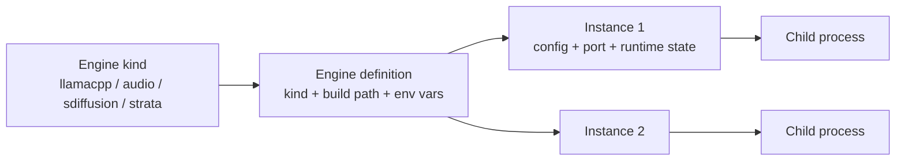

# LLM Engines

> Status: **Phases 1–3 implemented** (multi-instance manager, engine definitions,
> kind drivers + passthrough). Phase 4 (real non-llama drivers) pending.
> Related: `docs/todo.md` (item 21), `docs/proxy-server.md`, `docs/agent.md`

Allow spawning and monitoring **multiple LLM engine instances** — each with its own
binary/build, parameters, environment variables, and port — streaming each instance's
console output to the client.

Engine kinds in scope:

- llama.cpp (`llama-server` / `llama-cli`)
- audio.cpp
- stable-diffusion.cpp
- strata

Among others. There can be multiple instances and configs, settings, and environment
variables for each instance.

---

## 1. Current state (what exists today)

### 1.1 Process layer — single engine, single process

`LlamaProcessManager` (`src/server/llama.ts`) is a **singleton** holding exactly one
`ChildProcess`:

- `launch(config: LlamaConfig)` spawns `llama-server` or `llama-cli` from the single
  global `config.llamaCppPath`, merging `config.envVars` into the environment.
- stdout/stderr are line-buffered and pushed through `onLogLine`; status changes
  through `onStatusChange` (`stopped | starting | running | exited | error`).
- Multiple *models* are supported only through llama.cpp's own **router mode**
  (`--models-preset <ini>`, generated by `routerIni.ts` from `ModelConfig[]`) —
  still one process, one engine, one port.

### 1.2 Storage — one global config

`.config/` contains:

| File | Contents | Problem for multi-engine |
|---|---|---|
| `settings.json` | one global `LlamaConfig`: `llamaCppPath`, `host`, `port`, `envVars`, GPU prefs, `proxy` | path/port/env are global; only one build can be described |
| `models.json` | `ModelConfig[]` (alias, modelPath, params, templates) | configs are engine-agnostic in name but llama.cpp-flags-only in practice; no engine/kind field |
| `usage.db` | proxy usage rows | already keyed by backend id — mostly fine |

### 1.3 Transport — implicit single process

SSE (`GET /api/events`) broadcasts untagged events: `log-line`, `log-history`,
`process-status`, `metrics`, `model-metrics`, `model-status`. Every payload implicitly
refers to *the* process. In-memory replay caches (`logCache`, `proxyLogCache`) are
likewise singular.

### 1.4 Frontend — singleton state

`App.vue` keeps one `processStatus`, one `logLines` array, one `modelStatusData`.
`ConfigList.vue` manages one flat list of model configs with one Launch button
(single or router mode). `EnvironmentConfig.vue` validates exactly one build path.

### 1.5 Existing precedent — proxy backend kinds

The proxy gateway (`src/server/proxy/types.ts`) already models engine **kinds** as
HTTP upstreams:

```ts
type ProxyBackendKind =
  | 'llamacpp' | 'audio' | 'sdiffusion' | 'embeddings'
  | 'moderation' | 'videos' | 'default' | 'custom';
```

`proxyLlamaAliases()` auto-derives proxy routes from llama model configs. This is half
the engine abstraction already — it *connects* to engines but never *spawns* them.
**Reuse this enum as the canonical engine kind** rather than inventing a parallel one.

---

## 2. Proposed model

Three concepts, currently collapsed into one:



- **Engine kind** — the software family (llama.cpp, audio.cpp, …). Determines the
  driver: binary name(s), arg builder, version parser, log parser, metrics source.
- **Engine definition** — a named, reusable entry: kind + build folder + env vars.
  This generalizes today's single `EnvironmentConfig` into N entries (todo #11).
- **Instance** — an engine definition + a model/param config + a port. Launching
  creates a child process tracked by a stable `instanceId`.

### 2.1 EngineDriver interface (new)

Keep `LlamaProcessManager` generic (spawn / kill / line-stream / status) and move
engine-specific logic behind a per-kind driver:

```ts
interface EngineDriver {
  kind: ProxyBackendKind;               // reuse the proxy enum
  /** Binary name(s) inside the build folder, e.g. "llama-server" */
  serverBinary: string;
  buildArgs(instance: EngineInstance): string[];
  getVersion(buildPath: string): Promise<VersionInfo>;
  /** Parse one stdout/stderr line: level for coloring + optional metrics */
  parseLogLine(line: string): ParsedLine | null;
  /** Optional HTTP metrics source (llama.cpp /metrics poller, others n/a) */
  metricsSource?(instance: EngineInstance): MetricsSource | null;
}
```

Files: `src/server/engines/llama.ts` (move existing llama.cpp logic here),
`engines/audio.ts`, `engines/sd.ts`, `engines/strata.ts`, `engines/index.ts` (registry).
Unknown/custom kinds get a passthrough driver (spawn binary, stream raw logs, no
metrics).

### 2.2 Process manager per instance

Replace the singleton with a registry:

```ts
class EngineManager {
  private instances = new Map<string, ManagedInstance>();
  launch(instanceId: string): void;
  stop(instanceId: string): void;
  stopAll(): void;
  getStatus(instanceId: string): ProcessStatus;
}
```

`ManagedInstance` = driver + child + per-instance log cache + per-instance status.
Shutdown/restart endpoints call `stopAll()`.

### 2.3 Storage migration

```
.config/
  settings.json        # global prefs only (GPU, proxy); llamaCppPath/port move out
  engines.json         # EngineDefinition[]: {id, name, kind, buildPath, envVars}
  models.json          # ModelConfig gains: engineId, kind (default: legacy llama.cpp)
  instances.json       # optional: last-used instance layout
```

Back-compat: on load, if `settings.json` still has `llamaCppPath`/`port` and
`engines.json` is missing, synthesize one engine definition ("default", llama.cpp)
and rewrite. Existing `models.json` entries get `kind: 'llamacpp'` + the default
engine id. No destructive migration.

### 2.4 Ports

One global port becomes N. Auto-assign from a base (default 8080) with a conflict
check against other instances, the GUI port, and the proxy port; allow manual
override. Error surfaced in the launch response, not a crash.

### 2.5 SSE / API changes

Every process-scoped payload gains `instanceId`:

- `log-line` / `log-history` → `{ instanceId, entry }`; per-instance server-side cache
- `process-status` → `{ instanceId, status }`
- `metrics` / `model-status` → `{ instanceId, … }`
- REST: `/api/launch` → `/api/engines/:id/launch`, `/api/stop` →
  `/api/engines/:id/stop`; `/api/status` returns a map. Keep old endpoints as aliases
  to the default instance during transition.

### 2.6 Frontend

- **Instances bar/tab** above the existing layout: one chip per instance
  (name, kind, status badge, port), click to select the "active" instance.
- **Logs & Metrics panel** filters by selected instance (or merged view with an
  instance tag column — decide later).
- **ConfigList** gains an engine selector per config (which engine definition it
  runs on) and per-kind parameter sets (params.json becomes per-kind:
  `params.llamacpp.json`, `params.sdiffusion.json`, …).
- **EnvironmentConfig** becomes a list of engine definitions (add/edit/remove),
  each validated with the existing `/api/version/check` generalized per kind.
- Header status badge shows aggregate (`3 running / 1 stopped`) + selected instance.

---

## 3. Phased delivery (each phase independently shippable)

**Phase 1 — Multi-instance, single kind (llama.cpp only).**
Refactor `LlamaProcessManager` → `EngineManager` map; add `instanceId` to all SSE
payloads and log caches; storage migration; UI instances bar. One hidden default
instance keeps behavior identical — existing tests prove parity. Covers todo #12.

**Phase 2 — Multiple engine definitions (builds).**
`engines.json`, Environment dialog as a list, per-config `engineId`. Covers todo #11.

**Phase 3 — Engine kind drivers.**
`EngineDriver` interface; llama.cpp logic moved to `engines/llama.ts`; passthrough
driver for custom binaries; per-kind param sets.

**Phase 4 — Real non-llama drivers.**
audio.cpp, stable-diffusion.cpp, strata: version detection, arg builders, log
parsers, and (where they expose HTTP APIs) auto-register as proxy backends so the
gateway routes to spawned instances instead of hand-configured URLs.

---

## 4. Open questions

1. **audio.cpp / sd.cpp interfaces** — do they serve OpenAI-compatible HTTP, or are
   they CLI-only? Determines whether Phase 4 spawns-then-proxies or just spawns.
2. **strata** — is it a server, a launcher, or a manager over other engines? If it
   manages engines itself, it may be an *alternative host* rather than a kind.
3. **GPU allocation UX** — per-instance `CUDA_VISIBLE_DEVICES` picker (the OOM
   gotcha in `docs/agent.md` makes this important) or manual env entry only?
4. **Merged vs. filtered log view** — one stream with instance tags, or per-instance
   tabs? (Merged is simpler for SSE; filtered is simpler for the client.)
5. **Memory pressure** — N loaded models on shared VRAM: surface combined VRAM
   estimate before launch, or let it fail and show the log?
6. **Config templates per kind** — templates today are llama.cpp params; confirm
   each kind needs its own template set from day one.

## 5. Recommendations

- **Do Phase 1 first and alone.** The `instanceId` plumbing through SSE, caches, and
  the client is the risky part; doing it before any engine-kind abstraction keeps the
  blast radius small and testable.
- **Reuse `ProxyBackendKind`** as the engine kind enum — one vocabulary across proxy,
  spawner, and UI.
- **Don't build a generic arg-form UI in Phase 1.** Keep the existing params system
  for llama.cpp; generalize per-kind params only when a second real kind lands.
- **Keep the proxy as the integration point.** Spawned instances should auto-register
  as proxy backends (replacing the manual `baseUrl` entries in
  `DEFAULT_PROXY_SETTINGS`), so usage tracking and routing come for free.
- **Fix the metrics flags while refactoring.** `METRICS_PARSING_ENABLED` /
  `METRICS_POLLING_ENABLED` are both `false` in `llama.ts` / `index.ts`; per-instance
  polling should be revisited in Phase 1 so the poller takes an endpoint per instance.

---

## 6. UI design (agreed direction, v1)

### 6.1 Generic engine starter

Every engine instance is defined by the same generic core, regardless of kind:

| Field | Control |
|---|---|
| Name | text |
| Engine kind | dropdown (`ProxyBackendKind`) |
| Executable / build folder | path + validate button (per-kind `--version` probe) |
| Port | number, auto-assigned with conflict check |
| Environment variables | key/value rows, add/remove (replaces today's `envVars` editor) |
| Parameters | ordered rows of `{ key, value? }` — `--host 0.0.0.0` is key+value, `--metrics` is key-only (flag). Plus a "paste args" bulk mode using `splitArgs()`. |

Kind-specific UI is an **optional block** in the same dialog. For llama.cpp: a
*Router mode* toggle + model selection + `Edit config…` opening the existing model
config editor, and the generated `router.ini` preview/download. Other kinds get no
block until they need one.

**Params storage format:** generic `{ key, value? }[]` is the canonical storage for
instance args. The curated `ParamDef` editor for llama.cpp stays as a friendly
front-end that writes into the same list, so both the generic starter and the
llama.cpp GUI operate on one representation.

### 6.2 Layout: Engines tab + inline drawer + pinned logs

Tabs-per-instance rejected (does not scale, hides overall state). Instead a new
**Engines** tab in the existing right-column tab bar:

```
┌──────────────────────────────────────────────────────────────────────────┐
│ llama.cpp Config GUI (0.4.1)          [2 running / 1 stopped ▾]  ⟳ ⏻    │
├──────────────┬───────────────────────────────────────────────────────────┤
│ GPU Monitor  │ [Engines] [Proxy] [Usage]                    + New engine │
│ System Mon.  ├───────────────────────────────────────────────────────────┤
│ Usage Status │ ▸ llama-main   ● running  llamacpp  :8080   ⏹  ⚙  ⧉      │
│              │   ▸ Models (3 in router) [Edit config…] [router.ini]      │
│              │   ▸ Env  CUDA_VISIBLE_DEVICES=0   ▸ Params  -c 8192 …     │
│              │ ▸ sd-image     ● running  sdiffusion :7860   ⏹  ⚙  ⧉      │
│              │ ▸ audio-1      ○ stopped  audio     :8082    ▶  ⚙  ⧉      │
│              ├───────────────────────────────────────────────────────────┤
│              │ LOGS & METRICS  [llama-main ▾ | All]        ▾ Collapse    │
└──────────────┴───────────────────────────────────────────────────────────┘
```

- **Row**: `▸` toggles an inline drawer with a read-only summary (models, env,
  params); clicking a section opens the configure dialog. Status dot, kind, port,
  then `▶/⏹` start/stop, `⚙` configure, `⧉` duplicate, delete.
- **Log panel** gains an instance selector: `All` merges streams with an instance
  tag column, or pick one instance to filter. `LogView.vue` already receives
  `lines` as a prop — filtering/merging happens in the parent.
- **Header status badge** becomes aggregate (`2 running / 1 stopped`), click to jump
  to the Engines tab.
- **Configure dialog** reuses the existing `Dialog.vue` / `.editor-overlay` pattern.

### 6.3 Existing Models tab

`ConfigList` today conflates *model param configs* with *the one process*. Split:

- **Models tab** = the library of model configs (create/edit/clone/templates) —
  unchanged.
- A **llama.cpp instance** selects model configs for router mode (the checkbox set
  `ConfigList` already has), which is what generates its `router.ini`.

This keeps todo #11 (multiple builds) and #12 (multiple instances) separable and
avoids rewriting `ConfigEditor.vue`.
