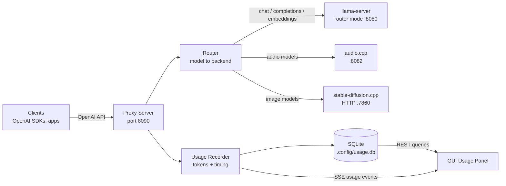
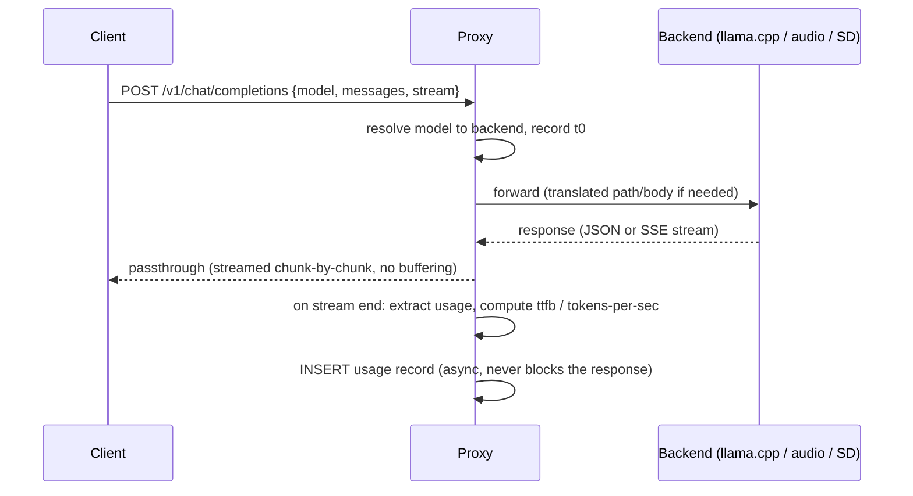

# Proxy / OpenAI-API Gateway Server — Specification

> Status: **Draft v1** — specification only, no implementation yet.
> Related: `docs/todo.md`, `docs/agent.md`

## 1. Goal

Run a lightweight **OpenAI-compatible reverse proxy** in front of the local inference
backends — **llama.cpp** (`llama-server`), **audio.ccp**, and **stable-diffusion.cpp** —
that:

1. Exposes a single OpenAI-style API surface on one port.
2. **Routes each request to the right backend based on the `model` field** in the request body.
3. **Captures and stores, for every request**: model name, input tokens, output tokens,
   timing (total duration, time-to-first-token, tokens/sec), and timestamp — plus enough
   context (endpoint, status, request id) to build per-model usage reports.

The proxy is a new subsystem **inside this project**, sharing the existing Express server
conventions, config storage (`.config/`), and Vue dashboard (new "Usage" panel).

## 2. Background: what already exists

| Existing piece | Relevance |
|---|---|
| `src/server/llama.ts` `LlamaProcessManager` | Already launches `llama-server` standalone or in **router mode** (`--router` + `router.ini`). The proxy sits *in front of* this server, not replacing it. |
| `src/server/routerIni.ts` | Model aliases (`[AliasName]` sections) — these aliases become the routing keys in the proxy's model registry. |
| `src/server/metricsPoller.ts` | Polls llama.cpp `/metrics` (Prometheus counters: `llama:prompt_tokens_total`, `llama:tokens_predicted_total`, processing seconds). Useful as a **cross-check**, not the primary capture mechanism (per-request data needs the response itself). |
| `src/server/config.ts` | `.config/settings.json` — proxy settings extend this. |
| SSE at `GET /api/events` | Reused to stream live usage events to the dashboard. |

## 3. Architecture



### 3.1 Component layout (new files)

```
src/server/proxy/
  index.ts          # createProxyApp(): Express app mounted at /v1 (+ /health)
  router.ts         # resolveBackend(modelName) -> BackendRef | null
  backends.ts       # backend registry + health probing
  recorder.ts       # UsageRecorder: builds UsageRecord from req/res, writes to DB
  usageDb.ts        # SQLite access layer (node:sqlite, Node 22+ built-in)
  tokenCount.ts     # fallback input-token counting (heuristic + /tokenize when available)
  types.ts          # ProxySettings, BackendRef, UsageRecord, UsageQuery
src/server/__tests__/
  proxy.test.ts
  proxyRouter.test.ts
  proxyRecorder.test.ts
  usageDb.test.ts
  fixtures/proxy/   # real captured OpenAI responses (incl. SSE streams)
```

The proxy runs as a **second Express app on its own port** (default `8090`), created by
`createProxyApp()` and started from `src/server/index.ts` when enabled in settings.
Keeping it on a separate port means the GUI's `/api/*` surface and the OpenAI surface
never collide, and the proxy can be exposed to the LAN independently of the GUI.

### 3.2 Request lifecycle



**Hard rule:** the proxy is a *transparent passthrough*. It never buffers streamed
responses and never fails a request because usage recording failed. Recording errors are
logged to the GUI log stream, not surfaced to the API client.

## 4. Model registry & routing

### 4.1 Registry

Routing is driven by a **model registry** derived from existing model configs
(`src/server/modelConfig.ts`) plus new backend fields. Each entry:

```ts
interface ProxyModelRoute {
  model: string;          // name clients send, e.g. "qwen2.5-14b", "sd-xl-turbo"
  backend: 'llamacpp' | 'audio' | 'sdiffusion';
  backendModel?: string;  // upstream model name if different (llama router alias)
  enabled: boolean;
}
```

- **llama.cpp models**: every enabled `ModelConfig` alias in the router INI is
  automatically routable (alias = model name). No duplication.
- **audio.ccp / stable-diffusion.cpp models**: declared in settings (see §8) with an
  alias-to-upstream mapping.

### 4.2 Routing rules (evaluated in order)

1. Exact match on `model` in the registry -> that backend.
2. Prefix match: `audio/...`, `sd/...`, `tts/...` -> corresponding backend (convention for
   clients that namespace models).
3. Path-based fallback: `POST /v1/audio/*` -> audio backend; `POST /v1/images/*` -> SD
   backend (when `model` is absent or unknown).
4. No match -> `404 { "error": { "message": "Unknown model \"x\"", "type": "invalid_request_error", "code": "model_not_found" } }`.

`GET /v1/models` returns the union of all enabled routes (with `created` and `owned_by`
set to the backend id), optionally live-merged from llama-server's `/models`.

### 4.3 Endpoint translation table

| Proxy endpoint | llama.cpp | audio.ccp | stable-diffusion.cpp |
|---|---|---|---|
| `POST /v1/chat/completions` | passthrough | passthrough if served; else translate `messages[-1]` into its TTS/STT input | reject (400) |
| `POST /v1/completions` | passthrough | reject | reject |
| `POST /v1/embeddings` | passthrough | reject | reject |
| `POST /v1/audio/speech` | router TTS models if any | passthrough / translate | reject |
| `POST /v1/audio/transcriptions` | whisper via llama-server if used | passthrough / translate | reject |
| `POST /v1/images/generations` | reject | reject | translate to SD HTTP API |
| `GET /v1/models` | merge `/models` | static | static |

Translation details for audio.ccp and stable-diffusion.cpp depend on their actual HTTP
APIs — **Phase 0 spike required** (see §11): document each upstream's real request/response
shape and capture fixtures before writing translators. The contract to clients is always
OpenAI shape; upstream differences are absorbed by per-backend translators.

## 5. Usage capture (tokens + timing)

### 5.1 What is recorded per request

```ts
interface UsageRecord {
  id: number;                  // rowid
  requestId: string;           // uuid, also returned in header X-Proxy-Request-Id
  timestamp: string;           // ISO-8601 with offset, request start time
  model: string;               // as requested by client
  backend: 'llamacpp' | 'audio' | 'sdiffusion';
  endpoint: string;            // e.g. "/v1/chat/completions"
  stream: boolean;
  status: number;              // upstream HTTP status
  inputTokens: number | null;
  outputTokens: number | null;
  cachedTokens: number | null; // KV-cache hits within inputTokens (upstream prompt_tokens_details.cached_tokens)
  tokensEstimated: boolean;    // true when counted heuristically
  totalDurationMs: number;     // t0 -> response fully sent
  ttfbMs: number | null;       // t0 -> first upstream byte/chunk
  tokensPerSec: number | null; // outputTokens / (tEnd - tFirstContentChunk)
  clientIp: string;
  errorMessage: string | null;
  meta: Record<string, unknown> | null; // steps/width/height/chars etc.
}
```

### 5.2 Token acquisition strategy (per backend)

**llama.cpp (authoritative, no tokenizer needed):**
- Non-streaming: response JSON contains `usage.prompt_tokens` / `usage.completion_tokens`.
- Streaming: the proxy **injects `stream_options: { include_usage: true }`** into the
  forwarded body when the client didn't set it, and parses the final usage-only SSE chunk.
  The usage chunk is **passed through as-is** (spec behavior; OpenAI SDKs tolerate it).
- Fallback when upstream omits usage (older builds, error responses): estimate input tokens
  with `tokenCount.ts` (chars/4 heuristic, refined later via llama-server `POST /tokenize`)
  and set `tokensEstimated = true`.

**audio.ccp:** TTS/STT token semantics differ. Record `inputTokens`/`outputTokens` when the
upstream reports them; otherwise record character counts in `meta` (`inputChars`,
`outputChars`) and leave token fields null. Timing is still captured.

**stable-diffusion.cpp:** no text tokens. Record `steps`, `width`, `height`, image count in
`meta`; token fields null; timing = full generation (no TTFB).

### 5.3 Timing

- `t0` = proxy has received the full request body.
- `tTTFB` = first byte of upstream response.
- `tEnd` = last byte flushed to client.
- Streaming `tokensPerSec` = `outputTokens / (tEnd - tFirstContentChunk)`; non-streaming =
  `outputTokens / (tEnd - tTTFB)`. Null when `outputTokens` is null.
- Cross-check: `metricsPoller` llama.cpp counters (`prompt_tokens_total`,
  `tokens_predicted_total`) should roughly match per-model DB sums. Asserted in tests as a
  sanity check, not a runtime dependency.

## 6. Storage

**SQLite** via `node:sqlite` (built into Node >= 22 / Bun; zero new runtime deps, matching
the project's minimal-dependency convention).

- File: `.config/usage.db` (same dir as `settings.json`; WAL mode).
- Schema, created/migrated in `usageDb.ts` using the `user_version` pragma:

```sql
CREATE TABLE IF NOT EXISTS usage (
  id INTEGER PRIMARY KEY AUTOINCREMENT,
  request_id TEXT NOT NULL,
  ts TEXT NOT NULL,                  -- ISO-8601 with offset
  model TEXT NOT NULL,
  backend TEXT NOT NULL,
  endpoint TEXT NOT NULL,
  stream INTEGER NOT NULL DEFAULT 0,
  status INTEGER NOT NULL,
  input_tokens INTEGER,
  output_tokens INTEGER,
  tokens_estimated INTEGER NOT NULL DEFAULT 0,
  total_ms INTEGER NOT NULL,
  ttfb_ms INTEGER,
  tokens_per_sec REAL,
  client_ip TEXT,
  error TEXT,
  meta TEXT                          -- JSON: steps/width/height/chars etc.
);
CREATE INDEX IF NOT EXISTS idx_usage_ts ON usage(ts);
CREATE INDEX IF NOT EXISTS idx_usage_model ON usage(model, ts);
```

- Retention: configurable `usageRetentionDays` (default 90); a daily task deletes old rows.
- Backup: none automatic; the file is small (one row per request).

### 6.1 Cost estimation

`ProxySettings.modelPricing` maps model name -> `{ input, cached, output }` USD price per
1M tokens. The Usage panel computes per-model and total cost as:

```
cost = ((inputTokens - cachedTokens) * input + cachedTokens * cached + outputTokens * output) / 1e6
```

Models without pricing show `--`. Pricing is edited via the 💵 Pricing dialog in the Usage
panel and persisted through `PUT /api/proxy/settings`.

## 7. Proxy management API (GUI server, `/api/proxy/*`)

| Method | Path | Purpose |
|---|---|---|
| GET | `/api/proxy/status` | enabled?, port, backend health summary |
| GET | `/api/proxy/usage` | query: `model`, `backend`, `from`, `to`, `limit`, `offset` -> rows |
| GET | `/api/proxy/usage/summary` | per-model: request count, sum in/out tokens, avg t/s, avg TTFB, last used |
| GET | `/api/proxy/usage/export?format=csv` | CSV download of filtered usage |
| GET/PUT | `/api/proxy/settings` | read/update proxy settings (see §8) |
| POST | `/api/proxy/models` | add an audio/SD route |
| PUT/DELETE | `/api/proxy/models/:model` | update/remove a route (llama routes are auto-derived, read-only) |

Live feed: a new SSE event `usage` on the existing `/api/events` stream — one event per
completed request (the `UsageRecord`) — so the dashboard updates in real time.

## 8. Configuration

Extends `.config/settings.json` (`LlamaConfig` in `src/server/types.ts`):

```ts
interface ProxySettings {
  enabled: boolean;              // runtime switch: true while the listener is running
  autoStart: boolean;            // start the proxy when the GUI server boots
  port: number;                  // default 8090
  host: string;                  // default 127.0.0.1 (LAN exposure is opt-in)
  apiKey: string;                // optional; if set, clients need Authorization: Bearer <key>
  usageRetentionDays: number;    // default 90
  backends: ProxyBackend[];      // user-managed list, add/edit/delete/remove in the GUI
  models: ProxyModelRoute[];     // declared routes; llama alias routes are derived from model configs
}

interface ProxyBackend {
  id: string;                    // slug derived from name, unique
  name: string;                  // display name, e.g. "audio.cpp"
  kind: 'llamacpp' | 'audio' | 'sdiffusion' | 'custom'; // endpoint compatibility + usage capture
  baseUrl: string;               // e.g. http://127.0.0.1:8082
  enabled: boolean;              // checkbox in the proxy list
  apiKey?: string;               // optional key the proxy sends upstream
  models?: string[];             // discovered via Refresh (upstream GET /v1/models)
  modelsFetchedAt?: string;      // ISO timestamp of last successful discovery
}
```

Backends are fully user-managed: the default list ships llama.cpp / audio.cpp / stable-diffusion.cpp
entries, but any can be edited, disabled, deleted, and new ones (any OpenAI-compatible upstream as
`custom`) can be added. `ProxyModelRoute.backend` references a backend by id. The legacy fixed-key
`backends` object shape is migrated to a list on load.

**Model discovery (Refresh):** each proxy row has a refresh button that probes the upstream's
`GET /v1/models` and stores the returned model ids on the backend (`models` / `modelsFetchedAt`).
Discovered models become auto routes, so multiple llama.cpp instances route by model name
(e.g. `llama-3.1-8b` -> backend A, `mistral-7b` -> backend B). Declared routes and llama aliases
take precedence over discovery; disabled backends contribute nothing.

Validation on save: ports unique, base URLs parseable, model aliases unique across the whole
registry (llama aliases + declared entries).

## 9. Security

- Bind `127.0.0.1` by default; LAN use requires an explicit host change in settings.
- Optional proxy API key (Bearer). If set, enforced on all `/v1/*` routes; upstream keys
  (llama `--api-key`) are attached by the proxy from settings, so clients never see them.
- Bodies streamed through without full buffering above a soft limit (e.g. 10 MB for JSON
  endpoints; multipart audio/image passthrough unbuffered).
- Never log request/response content — only metadata (model, endpoint, sizes, status).

## 10. GUI additions (later phase)

New **"Proxy & Usage"** panel on the dashboard:

```
+ Proxy ------------------- [ running :8090 ] ------------------+
| Backends: llama ok :8080   audio ok :8082   sd offline        |
+ Usage (last 24h) ----------------------------------------------+
| model            reqs   in tok   out tok   avg t/s  last      |
| qwen2.5-14b       142    98.2k    31.4k     41.2    2m        |
| sd-xl-turbo         9       --       --       --    15m       |
+ Recent requests (live SSE) -----------------------------------+
| 20:04:11  qwen2.5-14b  chat  stream  1.2k -> 318 tok  44 t/s  |
+---------------------------------------------------------------+
```

Components: `src/client/components/ProxyStatus.vue`, `UsageTable.vue`. Types added to
`src/client/types.ts` mirroring `UsageRecord`. Scoped CSS, dark theme, per project convention.

## 11. Implementation steps

Each step follows the `docs/agent.md` workflow: implement + test together, full suite green
(`npx vitest run`, `npx vite build`, `npx tsc -p tsconfig.server.json --noEmit`), show
output, commit only on explicit approval.

### Phase 0 — Upstream API spike (no code in repo)
1. Run **audio.ccp** and **stable-diffusion.cpp** HTTP servers locally; document their real
   request/response shapes (curl transcripts).
2. Capture **real fixtures**: llama-server streaming response with `stream_options`,
   non-streaming response with `usage`, SD generation response, audio TTS/STT responses.
   Save under `src/server/__tests__/fixtures/proxy/`.
   *Exit criteria:* translation table in §4.3 confirmed or corrected in this doc.

### Phase 1 — Usage store (`usageDb.ts`)
3. SQLite open/migrate helper; insert, query, summary, retention-purge functions.
4. Tests `usageDb.test.ts`: migration idempotency, insert/query round-trip, summary
   aggregation, retention purge.

### Phase 2 — Proxy core + llama.cpp routing
5. `createProxyApp()`: `/health`, `GET /v1/models`, `POST /v1/chat/completions`,
   `/v1/completions`, `/v1/embeddings` passthrough to llama-server via `node:http` piping
   (streaming-safe). `X-Proxy-Request-Id` header. Optional Bearer auth.
6. `router.ts`: registry + §4.2 resolution rules. Tests with a fixture-driven upstream stub
   (supertest + real `http.createServer`).
7. `recorder.ts`: timing (t0/TTFB/end), `stream_options.include_usage` injection, SSE
   usage-chunk parsing (incremental, buffer-safe across chunk boundaries), non-stream
   `usage` extraction, estimated-token fallback.
8. Tests `proxy.test.ts`, `proxyRouter.test.ts`, `proxyRecorder.test.ts` using Phase 0
   fixtures — assert DB rows match expected tokens/timing for streamed and non-streamed
   requests, and that a recording failure never breaks passthrough.

### Phase 3 — Backend health + settings wiring
9. `backends.ts`: parallel health probes (`GET /health` for llama, upstream-specific pings),
   10 s cache; 502 with an OpenAI-shaped error when a backend is down.
10. `ProxySettings` in `config.ts`/`types.ts` + `/api/proxy/settings` GET/PUT with
    validation. SSE `usage` event emission from the recorder.
11. Tests: `api.test.ts` additions for settings validation + status endpoint.

### Phase 4 — Stable-diffusion.cpp backend
12. Translator `POST /v1/images/generations` -> SD API; `meta` capture (steps/size); routing
    rules active. Tests from Phase 0 fixtures.

### Phase 5 — audio.ccp backend
13. Translators for `/v1/audio/speech` and `/v1/audio/transcriptions` (per Phase 0
    findings); character-count capture. Tests from fixtures.

### Phase 6 — Query/report API
14. `/api/proxy/usage`, `/usage/summary`, `/usage/export` (CSV). Retention purge timer.
15. Tests: filtering, pagination, CSV escaping, summary math.

### Phase 7 — GUI panel
16. Proxy & Usage panel (§10) with live SSE rows, per-model summary, CSV export button.
    Screenshot for review per working agreement.

### Phase 8 — Polish
17. README + CHANGELOG notes; `docs/todo.md` entries checked off; release flows through
    semantic-release as usual (`feat: add OpenAI-compatible proxy with usage tracking`).

## 12. Testing strategy

- **Unit:** router resolution, SSE usage-chunk parser (split mid-chunk, missing usage, error
  chunks), token estimation, summary SQL.
- **Integration:** supertest against `createProxyApp()` pointed at a stub upstream that
  replays real captured fixtures byte-for-byte (including chunked SSE timing).
- **End-to-end (manual):** GUI launches llama router -> proxy enabled -> `openai` Python
  client hits `http://127.0.0.1:8090/v1/chat/completions` -> row appears in the Usage panel.
- All fixtures are **real captured data**, per the project testing philosophy.

## 13. Open questions (resolve in Phase 0)

1. Exact audio.ccp HTTP API (paths, auth, streaming?) — determines translator scope.
2. Does the stable-diffusion.cpp build in use expose an HTTP server, or only CLI? If CLI,
   Phase 4 becomes "spawn per request" or requires an SD server component.
3. Are the llama.cpp builds in use new enough to always return `usage` in streaming with
   `stream_options`? (The fallback path covers older builds anyway.)
4. `node:sqlite` availability in the Bun-compiled release binary — verify in Phase 1; if
   unavailable, fall back to a JSONL append log + in-memory index behind the same interface.
5. Is `/v1/responses` (OpenAI Responses API) needed, or is chat/completions sufficient for
   v1? (This spec assumes chat/completions only.)
