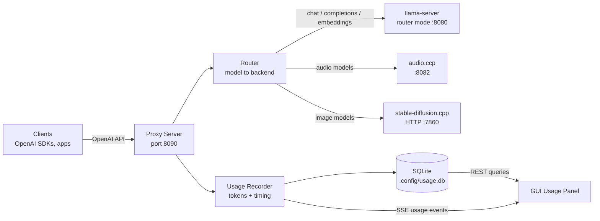
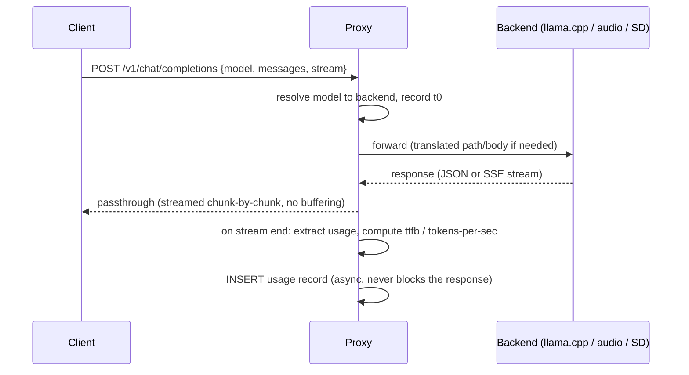

# Proxy / OpenAI-API Gateway Server — Specification

> Status: **Draft v1** — specification only, no implementation yet.
> Related: `docs/todo.md`, `docs/agent.md`

## 1. Goal

Run a lightweight **OpenAI-compatible reverse proxy** in front of the local inference
backends — **llama.cpp** (`llama-server`), **audio.ccp**, and **stable-diffusion.cpp** —
that:

1. Exposes a single OpenAI-style API surface on one port.
2. **Routes each request to the right backend based on the `model` field** in the request body.
3. **Captures and stores, for every request**: model name, input tokens, output tokens,
   timing (total duration, time-to-first-token, tokens/sec), and timestamp — plus enough
   context (endpoint, status, request id) to build per-model usage reports.

The proxy is a new subsystem **inside this project**, sharing the existing Express server
conventions, config storage (`.config/`), and Vue dashboard (new "Usage" panel).

## 2. Background: what already exists

| Existing piece | Relevance |
|---|---|
| `src/server/llama.ts` `LlamaProcessManager` | Already launches `llama-server` standalone or in **router mode** (`--router` + `router.ini`). The proxy sits *in front of* this server, not replacing it. |
| `src/server/routerIni.ts` | Model aliases (`[AliasName]` sections) — these aliases become the routing keys in the proxy's model registry. |
| `src/server/metricsPoller.ts` | Polls llama.cpp `/metrics` (Prometheus counters: `llama:prompt_tokens_total`, `llama:tokens_predicted_total`, processing seconds). Useful as a **cross-check**, not the primary capture mechanism (per-request data needs the response itself). |
| `src/server/config.ts` | `.config/settings.json` — proxy settings extend this. |
| SSE at `GET /api/events` | Reused to stream live usage events to the dashboard. |

## 3. Architecture



### 3.1 Component layout (new files)

```
src/server/proxy/
  index.ts          # createProxyApp(): Express app mounted at /v1 (+ /health)
  router.ts         # resolveBackend(modelName) -> BackendRef | null
  backends.ts       # backend registry + health probing
  recorder.ts       # UsageRecorder: builds UsageRecord from req/res, writes to DB
  usageDb.ts        # SQLite access layer (node:sqlite, Node 22+ built-in)
  tokenCount.ts     # fallback input-token counting (heuristic + /tokenize when available)
  types.ts          # ProxySettings, BackendRef, UsageRecord, UsageQuery
src/server/__tests__/
  proxy.test.ts
  proxyRouter.test.ts
  proxyRecorder.test.ts
  usageDb.test.ts
  fixtures/proxy/   # real captured OpenAI responses (incl. SSE streams)
```

The proxy runs as a **second Express app on its own port** (default `8090`), created by
`createProxyApp()` and started from `src/server/index.ts` when enabled in settings.
Keeping it on a separate port means the GUI's `/api/*` surface and the OpenAI surface
never collide, and the proxy can be exposed to the LAN independently of the GUI.

### 3.2 Request lifecycle



**Hard rule:** the proxy is a *transparent passthrough*. It never buffers streamed
responses and never fails a request because usage recording failed. Recording errors are
logged to the GUI log stream, not surfaced to the API client.

## 4. Model registry & routing

### 4.1 Registry

Routing is driven by a **model registry** derived from existing model configs
(`src/server/modelConfig.ts`) plus new backend fields. Each entry:

```ts
interface ProxyModelRoute {
  model: string;          // name clients send, e.g. "qwen2.5-14b", "sd-xl-turbo"
  backend: string;        // backend id
  backendModel?: string;  // upstream model name if different (llama router alias)
  enabled: boolean;
  active?: boolean;       // live route when several share the same alias
}
```

- **llama.cpp models**: every enabled `ModelConfig` alias in the router INI is
  automatically routable (alias = model name). No duplication.
- **audio.ccp / stable-diffusion.cpp models**: declared in settings (see §8) with an
  alias-to-upstream mapping.
- **Duplicate aliases**: several routes may share one `model` name pointing at
  different backends/upstream model ids. Exactly one is `active` (the live one);
  requests for that alias route to it. When duplicates exist, the proxy
  automatically prefers the route whose upstream model id is currently reported
  by that backend's model discovery (⟳ refresh) — so the alias follows whichever
  upstream model is actually loaded. Switching the live route manually (PUT with
  `active: true`) or deleting it (promotes a twin) still works. All upstream
  models stay visible in the GUI.

### 4.2 Routing rules (evaluated in order)

1. Exact match on `model` in the registry -> that backend.
2. Prefix match: `audio/...`, `sd/...`, `tts/...`, `embed/...`, `mod/...`, `video/...` ->
   corresponding backend (convention for clients that namespace models).
3. Path-based fallback: `POST /v1/audio/*` -> audio backend; `POST /v1/images/*` -> SD
   backend; `/v1/embeddings`, `/v1/moderations`, `/v1/videos` -> matching kind backend
   (when `model` is absent or unknown).
4. Catch-all: a backend with kind `default` receives anything not routed by the rules
   above (unknown/missing model names, endpoints with no matching kind backend).
   Requests targeting an *explicitly disabled* backend are still rejected (404).
5. No match -> `404 { "error": { "message": "Unknown model \"x\"", "type": "invalid_request_error", "code": "model_not_found" } }`.

`GET /v1/models` returns the union of all enabled routes (with `created` and `owned_by`
set to the backend id), optionally live-merged from llama-server's `/models`.

### 4.3 Endpoint translation table

Confirmed against live engines on 2026-10-25 (Phase 0 spike, §13). Fixtures:
`src/server/__tests__/fixtures/proxy/` — see its README for versions and provenance.

| Proxy endpoint | llama.cpp | audio.cpp | stable-diffusion.cpp |
|---|---|---|---|
| `POST /v1/chat/completions` | passthrough | reject (400) — no text-completion route exists | reject (400) |
| `POST /v1/completions` | passthrough | reject | reject |
| `POST /v1/embeddings` | passthrough | reject | reject |
| `POST /v1/audio/speech` | reject (400) — `AUDIO_KINDS` is `audio/default/custom` | passthrough — same OpenAI shape, plus `response_format:"json"` for timing and `stream:true` (pcm only) | reject |
| `POST /v1/audio/transcriptions` | reject (400) — whisper would need a `custom` backend | passthrough — same OpenAI shape; response has **no `usage`** | reject |
| `POST /v1/images/generations` | reject | reject | **translate to `POST /sdcpp/v1/img_gen`** (see §4.3.1) |
| `POST /v1/images/edits` | reject | reject | passthrough (raw multipart, shipped) |
| `GET /v1/models` | merge `/models` | static | static |

The audio.cpp routes need **no translation** — they already speak the OpenAI shape.
What they need is *recording*: neither returns `usage`, so audio usage is derived
from input characters and the `timing.audio_duration_ms` the upstream reports.

sd.cpp is the opposite: the OpenAI route exists but is a **lossy stub**, so the
translator must target the native API instead.

### 4.3.1 sd.cpp: why the OpenAI route cannot be the target

`POST /v1/images/generations` on `sd-server` reads exactly five fields —
`prompt`, `n`, `size`, `output_format`, `output_compression` — and nothing else
(`examples/server/routes_openai.cpp:build_openai_generation_request`). Verified
live in `sd/openai-generations.ignored-fields.json`: a request with
`steps:3, seed:777, response_format:"url", quality:"hd", style:"vivid"` came back
with `generation_info.sample_params.sample_steps = 20`, `seed = "42"`,
`txt_cfg = 1.0` — the server's startup defaults. `response_format`, `quality`,
`style` and `user` are never parsed at all, and the response is always
`data[].b64_json`, never `url`.

The only way to reach the real parameters through that route is the documented
`<sd_cpp_extra_args>` escape hatch embedded in `prompt`
(`sd/openai-generations.extra-args.json` proves it works: `sample_steps:7`
survives, and the block is stripped from the prompt before generation). It is a
compatibility shim, not an interface: it stringifies the request into the prompt,
and `seed` placed inside `sample_params` is silently ignored because `seed` is a
**top-level** field in the native schema.

`POST /sdcpp/v1/img_gen` is the real interface. It honours `sample_steps`, `seed`,
`sample_method`, `scheduler` and `guidance.txt_cfg` (all echoed back in
`generation_info`), and it is **asynchronous**: `202` +
`{id, kind, status:"queued", created, poll_url}`, then poll `GET /sdcpp/v1/jobs/{id}`
until `completed`/`failed`/`cancelled`. Timestamps are **milliseconds**. The
completed job carries `result.images[].{index, b64_json, generation_info}` and
`result.output_format`, and `completed - started` is the generation time excluding
queue time.

`GET /sdcpp/v1/capabilities` supplies the validation vocabulary for free:
`samplers` (22 names), `schedulers` (18), `output_formats_by_mode.img_gen`
(`png|jpeg|webp`), `limits` (`min/max width/height` 64..4096, `max_batch_count` 8,
`max_queue_size` 64) and `features_by_mode.img_gen` for the loaded context.

Consequences for Phase 4: the translator submits a native job and polls, so it
owns the queue wait and can report TTFB honestly; `response_format:"url"` cannot
be honoured (sd.cpp has no image hosting) and must be rejected or served as a
data URL; `quality`/`style` have no upstream equivalent and are rejected rather
than silently dropped, which is what the raw passthrough does today.

Requests behind the sd fixtures, for re-capture:

```bash
# ignored-fields.json — proves steps/seed/response_format/quality/style are dropped
curl -X POST :5458/v1/images/generations -H 'content-type: application/json' \
  -d '{"prompt":"a red cube on a table","n":1,"size":"64x64","steps":3,"seed":777,
       "response_format":"url","quality":"hd","style":"vivid","user":"alice"}'
# extra-args.json — the escape hatch (note: seed must be top-level, not in sample_params)
  -d '{"prompt":"a green cone <sd_cpp_extra_args>{\"sample_params\":{\"sample_steps\":7,\"seed\":99}}</sd_cpp_extra_args>",
       "size":"64x64","steps":3}'
# img_gen-job-submitted/completed.json — native, honours everything
curl -X POST :5458/sdcpp/v1/img_gen -H 'content-type: application/json' \
  -d '{"prompt":"a blue sphere","width":64,"height":64,"batch_count":1,"seed":1234,
       "sample_params":{"sample_steps":4,"sample_method":"euler","scheduler":"simple",
                        "guidance":{"txt_cfg":3.5}},"output_format":"png"}'
curl :5458/sdcpp/v1/jobs/<id>          # poll until completed
curl :5458/sdcpp/v1/capabilities
```

### 4.3.2 Phase 4 design: the sd.cpp image translator

Design decided 2026-10-25, grounded in the fixtures above and in
`examples/server/routes_sdcpp.cpp` / `examples/common/common.cpp`
(`SDGenerationParams::from_json_str`, `common.cpp:2105`).

**Where it hooks in.** `handleJson` keeps its current shape (resolve → kind gate
→ recorder) and gains one branch: when `req.path === '/v1/images/generations'`
**and** `backend.kind === 'sdiffusion'`, the request goes to
`handleSdImageGeneration()` in a new `src/server/proxy/sdTranslator.ts` instead
of `forward()`. `default`/`custom` backends keep the existing raw passthrough —
their upstream is a real OpenAI image server and must receive the body
untouched. `ENDPOINT_KINDS` is unchanged, so the gate stays
"kind can serve this endpoint", and the translator is a per-kind behaviour, not
a new routing rule.

**Why native and not `sd_cpp_extra_args`.** `from_json_str` merges the extra_args
JSON over the runtime defaults with the *same* schema as `img_gen`, so
parameter-wise the two paths are equivalent — but the payload has to be
stringified into the `prompt` string, the route stays synchronous (so the proxy
cannot distinguish queue wait from render, and the 5-minute idle budget is the
only ceiling), and `seed` inside `sample_params` is silently dropped because
`seed` is a top-level field (`common.cpp:2166`). The native route is the real
interface, is asynchronous, and echoes the effective parameters back in
`generation_info`. `docs/stable-diffusion.md` §1.5.1 said the opposite; that
decision is corrected there.

**Request mapping** (OpenAI → `POST /sdcpp/v1/img_gen`). Only fields the client
actually sent are written — the server starts from its own
`default_gen_params` (`routes_sdcpp.cpp:439`) and a translator that always
emitted defaults would override the instance's recipe.

| OpenAI field | Native field | Notes |
|---|---|---|
| `prompt` (string, required) | `prompt` | 400 `missing_prompt` when absent/not a string |
| `n` (int 1..8) | `batch_count` | same clamp upstream applies (`routes_openai.cpp:34`); `>8` → 400 (`limits.max_batch_count`) |
| `size` (`"WxH"`) | `width`, `height` | parsed like upstream (`find('x')`); malformed → 400 |
| `width` / `height` (ints) | `width`, `height` | accepted as an extension when `size` is absent; 64..4096 (`limits`) |
| `response_format` | — | `"b64_json"`/absent ok; `"url"` → 400 (sd.cpp hosts no images, §4.3.1) |
| `output_format` | `output_format` | `png`/`jpeg`/`webp` (`output_formats_by_mode.img_gen`) |
| `output_compression` | `output_compression` | passed through, upstream validates |
| `seed` | `seed` | **top level**, never inside `sample_params` |
| `steps` | `sample_params.sample_steps` | |
| `sampler` | `sample_params.sample_method` | validated against `samplers` only if a cached capabilities document exists |
| `scheduler` | `sample_params.scheduler` | ditto, `schedulers` |
| `guidance` (number) | `sample_params.guidance.txt_cfg` | |
| `negative_prompt` | `negative_prompt` | extension, mirrors `img_gen` |
| `user` | — | ignored (upstream never parses it) |
| `quality`, `style` | — | **400**, see below |
| `model` | — | selects the backend/route only; sd.cpp ignores it entirely |

**Rejected rather than dropped.** `quality` and `style` have no upstream
equivalent at all — silently dropping them would promise an effect that never
happens, so the translator answers
`400 invalid_request_error` naming the field. Same for
`response_format:"url"`. Anything else unknown is passed nowhere (the native
schema ignores unknown keys) and left unmentioned.

**Job lifecycle.** Submit `POST /sdcpp/v1/img_gen`; a `202` gives
`{id, poll_url}` (`routes_sdcpp.cpp:714-721`). Then poll `GET <poll_url>` every
**1 s** with a small backoff to 2 s, until `status` is
`completed` / `failed` / `cancelled`.

- Upstream `429 job queue is full` → `503` (retryable), `410 job expired` → `500`.
- Overall budget: `backend.timeoutMs ?? DEFAULT_UPSTREAM_IDLE_TIMEOUT_MS`
  (5 min) measured from submit, **not** per-poll — a 20-step 2048² render
  legitimately runs for minutes (`docs/stable-diffusion.md` §3.7). Poll
  requests themselves get a 10 s connect/response guard, reusing
  `sdRequest`-style fetch semantics.
- Budget exceeded → `POST <poll_url>/cancel` (best effort, fire-and-forget) and
  `504` with `code:"generation_timeout"`. `features_by_mode.img_gen` reports
  `cancel_generating`/`cancel_queued`, so cancel may be absent on old builds —
  the cancel result is never surfaced.
- Client abort (`res.on('close')` before the response is written) → same best-
  effort cancel, then record `499`. Unlike the passthrough path, abandoning the
  poll loop *can* free the queue, so asking is worth it even though a running
  render keeps its mutex.
- Nothing is streamed: the OpenAI image endpoint is JSON-in/JSON-out, so
  `rec.markTtfb()` fires when the completed job is written.

**Response mapping.** `result.images[].b64_json` → `data[].b64_json` (never
decoded or re-encoded — the base64 is copied through), `result.output_format`
drives the `created`/`revised` shape, and the reply is
`{created, data:[{b64_json}]}` with `X-Proxy-Request-Id` as on every other
endpoint. `generation_info` (which carries the *effective* prompt, seed,
sample_params and model files) is not forwarded to the client — it is
sd.cpp-specific — but its seed/steps/size go into the usage row.

**Usage recording.** Tokens stay `null` (no token concept); `estimatedInput` is
not applied to image endpoints, so the row is honest rather than a fake token
count. `meta` extends the existing image shape with what the job actually
ran: `{promptChars, steps, width, height, n, seed, outputFormat,
jobId, queueMs: started-created, renderMs: completed-started}`.
`totalDurationMs` covers submit→completion including queue wait, which is what
the client experienced.

**Validation without a capabilities round-trip.** The hot path does **not**
fetch `capabilities`: `img_gen` already validates and answers
`400 {"error":"invalid generation parameters"}`, and the translator maps an
upstream 4xx straight to an OpenAI-shaped `400` carrying the upstream message.
The local checks above (`size` parse, `n` range, `response_format`,
`quality`/`style`) are the only pre-flight. A cached capabilities document is a
**later** GUI concern (parameter picklists), not part of this path.

**Testing.** A stub `sd-server` replays the Phase 0 fixtures byte-for-byte:
`img_gen-job-submitted.json` on `POST /sdcpp/v1/img_gen`, then
`img_gen-job-completed.json` on the `poll_url` (queued → completed to exercise
the loop). Assert the translated body (top-level `seed`, `batch_count`,
`sample_params.sample_steps`), the OpenAI response shape, the usage row
(`tokens null`, `meta.renderMs`/`queueMs`), the `quality`/`response_format:"url"`
rejections, upstream-400 mapping, and the timeout→cancel path with a stub that
never completes. Poll interval is injected so tests do not sleep for seconds.


## 5. Usage capture (tokens + timing)

### 5.1 What is recorded per request

```ts
interface UsageRecord {
  id: number;                  // rowid
  requestId: string;           // uuid, also returned in header X-Proxy-Request-Id
  timestamp: string;           // ISO-8601 with offset, request start time
  model: string;               // as requested by client
  backend: 'llamacpp' | 'audio' | 'sdiffusion';
  endpoint: string;            // e.g. "/v1/chat/completions"
  stream: boolean;
  status: number;              // upstream HTTP status
  inputTokens: number | null;
  outputTokens: number | null;
  cachedTokens: number | null; // KV-cache hits within inputTokens (upstream prompt_tokens_details.cached_tokens)
  tokensEstimated: boolean;    // true when counted heuristically
  totalDurationMs: number;     // t0 -> response fully sent
  ttfbMs: number | null;       // t0 -> first upstream byte/chunk
  tokensPerSec: number | null; // outputTokens / (tEnd - tFirstContentChunk)
  clientIp: string;
  errorMessage: string | null;
  meta: Record<string, unknown> | null; // steps/width/height/chars etc.
}
```

### 5.2 Token acquisition strategy (per backend)

**llama.cpp (authoritative, no tokenizer needed):**
- Non-streaming: response JSON contains `usage.prompt_tokens` / `usage.completion_tokens`.
- Streaming: the proxy **injects `stream_options: { include_usage: true }`** into the
  forwarded body when the client didn't set it, and parses the final usage-only SSE chunk.
  The usage chunk is **passed through as-is** (spec behavior; OpenAI SDKs tolerate it).
- Fallback when upstream omits usage (older builds, error responses): estimate input tokens
  with `tokenCount.ts` (chars/4 heuristic, refined later via llama-server `POST /tokenize`)
  and set `tokensEstimated = true`.

**audio.ccp:** TTS/STT token semantics differ. Record `inputTokens`/`outputTokens` when the
upstream reports them; otherwise record character counts in `meta` (`inputChars`,
`outputChars`) and leave token fields null. Timing is still captured.

**stable-diffusion.cpp:** no text tokens. Record `steps`, `width`, `height`, image count in
`meta`; token fields null; timing = full generation (no TTFB).

### 5.3 Timing

- `t0` = proxy has received the full request body.
- `tTTFB` = first byte of upstream response.
- `tEnd` = last byte flushed to client.
- Streaming `tokensPerSec` = `outputTokens / (tEnd - tFirstContentChunk)`; non-streaming =
  `outputTokens / (tEnd - tTTFB)`. Null when `outputTokens` is null.
- Cross-check: `metricsPoller` llama.cpp counters (`prompt_tokens_total`,
  `tokens_predicted_total`) should roughly match per-model DB sums. Asserted in tests as a
  sanity check, not a runtime dependency.

## 6. Storage

**SQLite** via `node:sqlite` (built into Node >= 22 / Bun; zero new runtime deps, matching
the project's minimal-dependency convention).

- File: `.config/usage.db` (same dir as `settings.json`; WAL mode).
- Schema, created/migrated in `usageDb.ts` using the `user_version` pragma:

```sql
CREATE TABLE IF NOT EXISTS usage (
  id INTEGER PRIMARY KEY AUTOINCREMENT,
  request_id TEXT NOT NULL,
  ts TEXT NOT NULL,                  -- ISO-8601 with offset
  model TEXT NOT NULL,
  backend TEXT NOT NULL,
  endpoint TEXT NOT NULL,
  stream INTEGER NOT NULL DEFAULT 0,
  status INTEGER NOT NULL,
  input_tokens INTEGER,
  output_tokens INTEGER,
  tokens_estimated INTEGER NOT NULL DEFAULT 0,
  total_ms INTEGER NOT NULL,
  ttfb_ms INTEGER,
  tokens_per_sec REAL,
  client_ip TEXT,
  error TEXT,
  meta TEXT                          -- JSON: steps/width/height/chars etc.
);
CREATE INDEX IF NOT EXISTS idx_usage_ts ON usage(ts);
CREATE INDEX IF NOT EXISTS idx_usage_model ON usage(model, ts);
```

- Retention: configurable `usageRetentionDays` (default 90); a daily task deletes old rows.
- Backup: none automatic; the file is small (one row per request).

### 6.1 Cost estimation

`ProxySettings.modelPricing` maps model name -> `{ input, cached, output }` USD price per
1M tokens. The Usage panel computes per-model and total cost as:

```
cost = ((inputTokens - cachedTokens) * input + cachedTokens * cached + outputTokens * output) / 1e6
```

Models without pricing show `--`. Pricing is edited via the 💵 Pricing dialog in the Usage
panel and persisted through `PUT /api/proxy/settings`.

## 7. Proxy management API (GUI server, `/api/proxy/*`)

| Method | Path | Purpose |
|---|---|---|
| GET | `/api/proxy/status` | enabled?, port, backend health summary |
| GET | `/api/proxy/usage` | query: `model`, `backend`, `from`, `to`, `limit`, `offset` -> rows |
| GET | `/api/proxy/usage/summary` | per-model: request count, sum in/out tokens, avg t/s, avg TTFB, last used |
| GET | `/api/proxy/usage/export?format=csv` | CSV download of filtered usage |
| GET/PUT | `/api/proxy/settings` | read/update proxy settings (see §8) |
| POST | `/api/proxy/models` | add an audio/SD route |
| PUT/DELETE | `/api/proxy/models/:model` | update/remove a route (llama routes are auto-derived, read-only) |

Live feed: a new SSE event `usage` on the existing `/api/events` stream — one event per
completed request (the `UsageRecord`) — so the dashboard updates in real time.

## 8. Configuration

Extends `.config/settings.json` (`LlamaConfig` in `src/server/types.ts`):

```ts
interface ProxySettings {
  enabled: boolean;              // runtime switch: true while the listener is running
  autoStart: boolean;            // start the proxy when the GUI server boots
  port: number;                  // default 8090
  host: string;                  // default 127.0.0.1 (LAN exposure is opt-in)
  apiKey: string;                // optional; if set, clients need Authorization: Bearer <key>
  usageRetentionDays: number;    // default 90
  backends: ProxyBackend[];      // user-managed list, add/edit/delete/remove in the GUI
  models: ProxyModelRoute[];     // declared routes; llama alias routes are derived from model configs
}

interface ProxyBackend {
  id: string;                    // slug derived from name, unique
  name: string;                  // display name, e.g. "audio.cpp"
  kind: 'llamacpp' | 'embeddings' | 'audio' | 'sdiffusion' | 'moderation' | 'videos' | 'default' | 'custom'; // endpoint compatibility + usage capture; 'default' = catch-all fallback
  baseUrl: string;               // e.g. http://127.0.0.1:8082
  enabled: boolean;              // checkbox in the proxy list
  apiKey?: string;               // optional key the proxy sends upstream
  models?: string[];             // discovered via Refresh (upstream GET /v1/models)
  modelsFetchedAt?: string;      // ISO timestamp of last successful discovery
}
```

Backends are fully user-managed: the default list ships llama.cpp / audio.cpp / stable-diffusion.cpp
entries, but any can be edited, disabled, deleted, and new ones (any OpenAI-compatible upstream as
`custom`) can be added. `ProxyModelRoute.backend` references a backend by id. The legacy fixed-key
`backends` object shape is migrated to a list on load.

**Model discovery (Refresh):** each proxy row has a refresh button that probes the upstream's
`GET /v1/models` and stores the returned model ids on the backend (`models` / `modelsFetchedAt`).
Discovered models become auto routes, so multiple llama.cpp instances route by model name
(e.g. `llama-3.1-8b` -> backend A, `mistral-7b` -> backend B). Declared routes and llama aliases
take precedence over discovery; disabled backends contribute nothing.

Validation on save: ports unique, base URLs parseable, model aliases unique across the whole
registry (llama aliases + declared entries).

## 9. Security

- Bind `127.0.0.1` by default; LAN use requires an explicit host change in settings.
- Optional proxy API key (Bearer). If set, enforced on all `/v1/*` routes; upstream keys
  (llama `--api-key`) are attached by the proxy from settings, so clients never see them.
- Bodies streamed through without full buffering above a soft limit (e.g. 10 MB for JSON
  endpoints; multipart audio/image passthrough unbuffered).
- Never log request/response content — only metadata (model, endpoint, sizes, status).

## 10. GUI additions (later phase)

New **"Proxy & Usage"** panel on the dashboard:

```
+ Proxy ------------------- [ running :8090 ] ------------------+
| Backends: llama ok :8080   audio ok :8082   sd offline        |
+ Usage (last 24h) ----------------------------------------------+
| model            reqs   in tok   out tok   avg t/s  last      |
| qwen2.5-14b       142    98.2k    31.4k     41.2    2m        |
| sd-xl-turbo         9       --       --       --    15m       |
+ Recent requests (live SSE) -----------------------------------+
| 20:04:11  qwen2.5-14b  chat  stream  1.2k -> 318 tok  44 t/s  |
+---------------------------------------------------------------+
```

Components: `src/client/components/ProxyStatus.vue`, `UsageTable.vue`. Types added to
`src/client/types.ts` mirroring `UsageRecord`. Scoped CSS, dark theme, per project convention.

## 11. Implementation steps

Each step follows the `docs/agent.md` workflow: implement + test together, full suite green
(`npx vitest run`, `npx vite build`, `npx tsc -p tsconfig.server.json --noEmit`), show
output, commit only on explicit approval.

### Phase 0 — Upstream API spike ✅ (done 2026-10-25)
1. Ran **audio.cpp** and **stable-diffusion.cpp** HTTP servers locally (plus the running
   llama.cpp router) and documented their real request/response shapes — §4.3.1 and §13.
2. Captured **real fixtures** under `src/server/__tests__/fixtures/proxy/`:
   llama streaming with `stream_options` + non-streaming with `usage`; SD OpenAI route
   (ignored-fields proof + `sd_cpp_extra_args`), native `img_gen` submit/poll, and
   `capabilities`; audio TTS (wav/json/streaming SSE) and STT. Fixture README records the
   engine versions and how to re-capture.
   *Exit criteria met:* §4.3 corrected (audio needs no translation; SD must target the
   native API), §13 Q1–Q3 answered. Q4 (`node:sqlite` in the Bun binary) stays open —
   it needs a built release binary, not a live server.

### Phase 1 — Usage store (`usageDb.ts`)
3. SQLite open/migrate helper; insert, query, summary, retention-purge functions.
4. Tests `usageDb.test.ts`: migration idempotency, insert/query round-trip, summary
   aggregation, retention purge.

### Phase 2 — Proxy core + llama.cpp routing
5. `createProxyApp()`: `/health`, `GET /v1/models`, `POST /v1/chat/completions`,
   `/v1/completions`, `/v1/embeddings` passthrough to llama-server via `node:http` piping
   (streaming-safe). `X-Proxy-Request-Id` header. Optional Bearer auth.
6. `router.ts`: registry + §4.2 resolution rules. Tests with a fixture-driven upstream stub
   (supertest + real `http.createServer`).
7. `recorder.ts`: timing (t0/TTFB/end), `stream_options.include_usage` injection, SSE
   usage-chunk parsing (incremental, buffer-safe across chunk boundaries), non-stream
   `usage` extraction, estimated-token fallback.
8. Tests `proxy.test.ts`, `proxyRouter.test.ts`, `proxyRecorder.test.ts` using Phase 0
   fixtures — assert DB rows match expected tokens/timing for streamed and non-streamed
   requests, and that a recording failure never breaks passthrough.

### Phase 3 — Backend health + settings wiring
9. `backends.ts`: parallel health probes (`GET /health` for llama, upstream-specific pings),
   10 s cache; 502 with an OpenAI-shaped error when a backend is down.
10. `ProxySettings` in `config.ts`/`types.ts` + `/api/proxy/settings` GET/PUT with
    validation. SSE `usage` event emission from the recorder.
11. Tests: `api.test.ts` additions for settings validation + status endpoint.

### Phase 4 — Stable-diffusion.cpp backend
12. Translator `POST /v1/images/generations` -> native `POST /sdcpp/v1/img_gen` +
    job polling, per the design in §4.3.2 (`src/server/proxy/sdTranslator.ts`);
    `meta` capture (steps/size/seed/queue+render ms); routing rules active.
    Tests replay the Phase 0 `sd/` fixtures through a stub `sd-server`.

### Phase 5 — audio.ccp backend
13. Translators for `/v1/audio/speech` and `/v1/audio/transcriptions` (per Phase 0
    findings); character-count capture. Tests from fixtures.

### Phase 6 — Query/report API
14. `/api/proxy/usage`, `/usage/summary`, `/usage/export` (CSV). Retention purge timer.
15. Tests: filtering, pagination, CSV escaping, summary math.

### Phase 7 — GUI panel
16. Proxy & Usage panel (§10) with live SSE rows, per-model summary, CSV export button.
    Screenshot for review per working agreement.

### Phase 8 — Polish
17. README + CHANGELOG notes; `docs/todo.md` entries checked off; release flows through
    semantic-release as usual (`feat: add OpenAI-compatible proxy with usage tracking`).

## 12. Testing strategy

- **Unit:** router resolution, SSE usage-chunk parser (split mid-chunk, missing usage, error
  chunks), token estimation, summary SQL.
- **Integration:** supertest against `createProxyApp()` pointed at a stub upstream that
  replays real captured fixtures byte-for-byte (including chunked SSE timing).
- **End-to-end (manual):** GUI launches llama router -> proxy enabled -> `openai` Python
  client hits `http://127.0.0.1:8090/v1/chat/completions` -> row appears in the Usage panel.
- All fixtures are **real captured data**, per the project testing philosophy.

## 13. Open questions (resolve in Phase 0)

All five answered by the 2026-10-25 spike; fixtures in
`src/server/__tests__/fixtures/proxy/`.

1. **Exact audio.cpp HTTP API** — answered. `GET /health`, `GET /v1/models`
   (`owned_by:"engine"`), `POST /v1/audio/speech`,
   `POST /v1/audio/transcriptions` (+ `/details`, `/live`, `/v1/batches/…`,
   `/v1/audio/alignments`). No auth on the core API; `--cors-origins` for the UI.
   Both OpenAI routes already speak the OpenAI shape, so **no translation is
   needed** — only recording. Two catches: streaming speech accepts
   **`response_format:"pcm"` only** (any other value is a 500) and emits
   audio.cpp's own events (`speech.audio.delta` with b64 PCM, then
   `speech.audio.done` with `timing.ttft_ms`), and neither route returns `usage`,
   so audio usage must be derived from input characters and
   `timing.audio_duration_ms`. Scope for Phase 5 is therefore *recording*, not
   translating.
2. **Does the sd.cpp build expose HTTP?** — answered: **yes**, `sd-server` serves
   the OpenAI, `sdapi` and native `sdcpp` families plus a Web UI. No per-request
   spawn needed. But the OpenAI family is a lossy stub (§4.3.1), so Phase 4
   translates to `POST /sdcpp/v1/img_gen` and polls the job.
3. **Are the llama.cpp builds new enough for streaming `usage`?** — answered:
   **yes**, `b11835` returns the usage chunk with `stream_options.include_usage`
   (`llama/chat-stream.sse`: final chunk, `"choices":[]`, plus `timings`).
   Also confirmed the fallback is genuinely needed: **without** `stream_options`
   the server emits **zero** usage chunks, so the proxy's injection in
   `handleJson` is load-bearing, not decorative.
4. **`node:sqlite` in the Bun-compiled binary** — **not resolved by this spike**
   (needs a built release binary, not a live server). Still open; tracked in
   `docs/todo.md` #20.
5. **Is `/v1/responses` needed?** — unchanged for v1: chat/completions only. The
   spike found no reason to revisit it.

