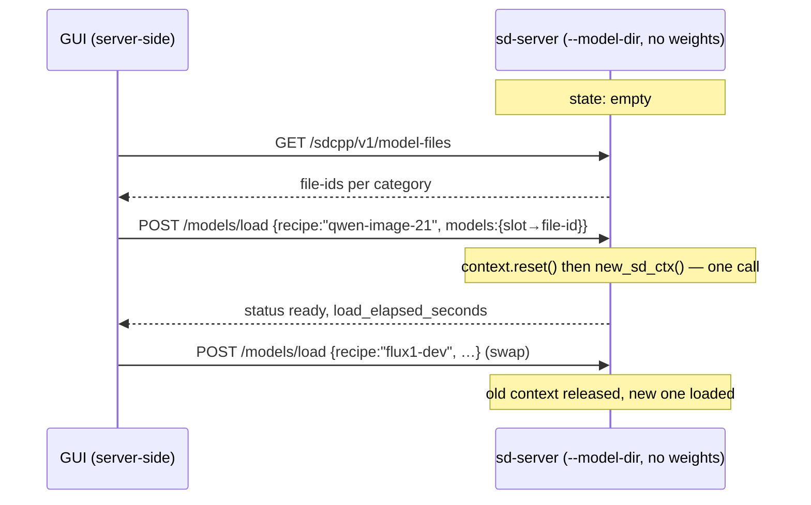

# stable-diffusion.cpp engine — integration spec

Status: **spec final — all decisions locked, §5 has no open questions left**
(2026-10-25). Ready for implementation (§4).
Model handling is **Option A: hot swap over `/sdcpp/v1/models/load`** — the
server starts with `--model-dir` and no weights, and every model arrives as a
recipe + file-id selection (§1.4.1, §3.10). One instance serves many cards.
Engine facts verified against the local checkout `~/Programs/AI/stable-diffusion.cpp`
(build `build/bin/{sd-cli,sd-server}`, version banner
`stable-diffusion.cpp version master-1004-a85db96-2-g0886f11, commit 0886f11`)
and upstream `https://github.com/leejet/stable-diffusion.cpp` @ `0886f11`.
File references are paths in **that** repo. The GUI design (§3) follows the
audio.cpp precedent (`docs/audio.md`) and the engine architecture
(`docs/llm-engines.md` §2, todo #21 Phase 4).

---

## 1. Engine facts

### 1.1 Two binaries, one flag vocabulary

| Binary | Shape | Relevance |
|---|---|---|
| `build/bin/sd-cli` | one-shot: load → generate → write file → exit | parameter catalog source (`-h`), convert mode, "run once" escape hatch |
| `build/bin/sd-server` | resident HTTP server + embedded Web UI | **the thing this GUI launches** |

`sd-server -h` prints three groups: **Svr Options**, **Context Options**,
**Default Generation Options**. `sd-cli -h` prints **CLI Options**, **Context
Options**, **Generation Options**. *Context Options are byte-identical between
the two* — one model/component/backend vocabulary, so a single catalog covers
both.

Decided: **sd-server only.** sd-cli stays reachable through the Command tab /
extraArgs, not as a second instance shape.

### 1.2 Server options (`examples/server/main.cpp`)

| Flag | Default | Notes |
|---|---|---|
| `-l, --listen-ip <ip>` | `127.0.0.1` | bind address |
| `--listen-port <int>` | `1234` | **not** `--port`; the port row must be `--listen-port` |
| `--model-dir <dir>` | `models` | repeatable; the model root(s) the Web UI / `/sdcpp/v1/model-files` scan |
| `--serve-html-path <file>` | — | serve a custom UI at `/` |
| `--log-level <lvl>` | `info` | `debug verbose info warn error` |
| `-v, --verbose` | — | = `--log-level verbose` |
| `--color` | — | colored level tags (we do **not** want this in a log pipe) |

Plus every Context Option and Default Generation Option below.

### 1.3 The component model — what files exist and who downloads them

A generation is never "one model". It is a **set of independent weight files**,
one CLI flag each. The canonical vocabulary is the server's own slot table
(`examples/server/model_catalog.cpp: k_model_slots`), which also names the
directory the Web UI scans for each:

| Flag | Slot id | Scanned dir | What it is |
|---|---|---|---|
| `-m, --model` | `model` | `checkpoints/` (alias `Stable-diffusion/`) | **All-in-one checkpoint**: UNet/DiT + text encoders + VAE bundled. SD1.5 / SD2 / SDXL / SD3.5 `.safetensors`/`.ckpt`. For classic SD this is the *only* file needed. |
| `--diffusion-model` | `diffusion_model` | `diffusion_models/` | The **UNet/DiT alone**, when the checkpoint is split. Flux, Qwen-Image, Z-Image, Wan, Chroma… are normally used this way. |
| `--high-noise-diffusion-model` | `high_noise_diffusion_model` | `diffusion_models/` | Wan2.2 MoE second transformer (high-noise half). Pairs with `--high-noise-steps` / `--moe-boundary`. |
| `--uncond-diffusion-model` | `uncond_diffusion_model` | `diffusion_models/` | Ideogram4 CFG only. |
| `--clip_l` | `clip_l` | `text_encoders/` | **CLIP-L text encoder** (~250 MB). SDXL needs it; Flux needs it. |
| `--clip_g` | `clip_g` | `text_encoders/` | **CLIP-G text encoder**. SDXL and SD3.5 need it *in addition to* clip_l. |
| `--t5xxl` | `t5xxl` | `text_encoders/` | **T5-XXL text encoder** (~5–10 GB fp16). Flux, SD3.5. |
| `--llm` | `llm` | `text_encoders/` | **An LLM used as the text encoder** — the "VL text encoder". Qwen-Image → `Qwen2.5-VL-7B-Instruct`, Flux.2 → `mistral-small3.2`, Ideogram4 similar. It is prompt understanding, not chat. Downloaded **separately**, usually as GGUF. |
| `--llm_vision` | `llm_vision` | `text_encoders/`, `clip_vision/` | **The vision projector**: a ViT + projection layer that lets that VL encoder *see* input images. Needed for image-**editing** (Qwen-Image-Edit, Flux-Kontext) when the projector is **not** bundled inside the encoder file. So: separate download only in the "separate GGUF text encoder" case. (`--qwen2vl` / `--qwen2vl_vision` are deprecated aliases.) |
| `--clip_vision` | `clip_vision` | `clip_vision/` | CLIP-ViT image encoder for **IP-Adapter**. Different thing from `--llm_vision`. |
| `--tokenizer` | `tokenizer` | `tokenizers/` | `tokenizer.json`, or `main=F,clip-l=F,clip-g=F`. Required for PiD / Lens and for some separate encoders. Tiny. |
| `--vae` | `vae` | `vae/` | **VAE**, pixel ↔ latent. Bundled in classic checkpoints; separate for Flux (`ae.safetensors`), Qwen-Image, Wan, SD3. |
| `--vae-format` | — | — | `auto flux sd3 flux2 wan` latent-format override (PiD variants). |
| `--taesd` / `--tae` | `tae`/`taesd` | `vae/`, `vae_approx/` | **Tiny AutoEncoder**: cheap decode for step previews (`--preview tae`) or low-quality fast output. Optional, small. |
| `--audio-vae` | `audio_vae` | `vae/` | LTX audio VAE. Video/audio models only. |
| `--audio-encoder` | `audio_encoder` | `text_encoders/` | wav2vec2 encoder (Wan2.2 S2V). |
| `--embeddings-connectors` | `embeddings_connectors` | `text_encoders/` | LTXAV embeddings connectors. |
| `--control-net` | `control_net` | `controlnet/` | ControlNet (SD1.5). + `--control-image`, `--control-strength`. |
| `--ip-adapter` | `ip_adapter` | `ipadapter/` | IP-Adapter (SD1.5/SDXL). Requires `--clip_vision`. + `--ip-adapter-image`, `--ip-adapter-strength`. |
| `--motion-module` | `motion_module` | `motion_modules/` | AnimateDiff (SD1.5). |
| `--photo-maker` | `photo_maker` | `photomaker/` | PhotoMaker. |
| `--pulid-weights` | `pulid_weights` | `pulid/` | PuLID (Flux). |
| `--upscale-model` | — | — | **ESRGAN** upscaler, used by `-M upscale` + `--upscale-repeats`. |
| `--ad-model` | — | — | converted **YOLOv8** detector for ADetailer. |
| `--lora-model-dir` | — | — | LoRAs are **not a slot**: a *directory*. Individual LoRAs are picked per request (`<lora:name:1>` in the CLI prompt; structured fields in the HTTP APIs — server APIs deliberately reject `<lora:…>` tags). |
| `--embd-dir` | — | — | textual-inversion embeddings directory. |
| `--hires-upscalers-dir` | — | — | directory of highres-fix upscaler models. |

**Answer to the open question in one line:** the diffusion model, the text
encoder(s) and the VAE are the three required pieces; `--llm` *is* the VL text
encoder and `--llm_vision` *is* its projector (separate download only when the
encoder file does not bundle it); everything else is an optional add-on.

#### 1.3.1 Model root layout — one folder per model (decided)

A flat `models/{diffusion_models,text_encoders,vae}` tree mixes every model's
parts together, so nothing says which encoder or VAE belongs to which
checkpoint. **Decided: one root per model**, each with its own category dirs,
**all grouped under a single `sd/` parent** so everything sd.cpp reads is in one
place (the shared `models/` root also holds llama.cpp / audio GGUFs, which must
not be scanned by `--model-dir`):

```
~/Programs/AI/models/sd/
  qwen-image-2.1/
    diffusion_models/qwen_image_2.1-Q4_K.gguf
    text_encoders/Qwen3VL-8B-Instruct-Q4_K_M.gguf
    text_encoders/mmproj-Qwen3VL-8B-Instruct-F16.gguf
    vae/qwen_image_2.1_vae_bf16.safetensors
    vae/taeqi2_1.safetensors
    loras/                    # optional, model-specific
    recipes/                  # optional, model-specific user recipes
  wan2.2-ti2v-5b/…
  sd1.5/checkpoints/v1-5-pruned-emaonly.safetensors
```

`~/Programs/AI/models/sd` is **not itself a model root** — its children are. Pointing
`--model-dir` at `…/models/sd` finds nothing, because category dirs must be
*immediate* children of the root.

`--model-dir` is **repeatable** and each root is scanned independently
(`model_catalog.cpp:116`, `runtime.cpp:372`; *"Repeated `--model-dir` arguments
merge roots in order"*), and the category dirs must be **immediate children** of
the root (`model_category_directories` matches only direct children whose name
equals the category). So the GUI emits one `--model-dir` per model folder it
discovers under `sd/`.

Four consequences, all verified:

1. **File-ids are root-qualified.** The first root keeps plain ids
   (`diffusion_models/x.gguf`); every later root prefixes `@<16-hex-hash>/…`,
   derived from the root's canonical path. Renaming a folder changes its ids —
   cards store **paths**, and ids are resolved live from
   `GET /sdcpp/v1/model-files` (§3.3), never persisted.
2. **Shared components duplicate.** `clip_l`/`t5xxl`/`ae.safetensors` are shared
   by many Flux variants, so per-model folders mean N copies. Dedup caveat: the
   scan canonicalises and rejects anything failing `model_path_inside(root, …)`
   — a **symlink pointing outside its root is rejected** ("path escapes model
   directory"). Hard links inside the same filesystem are fine.
3. **Recipes travel with the model.** `<root>/recipes/*.json` is scanned per
   root and *"the earliest root containing a valid user recipe wins"*, so a
   custom recipe lives next to the model it describes.
4. **LoRAs scope per root** (`runtime.cpp:424` → `model_category_directories(root,
   "loras")`), so a model-specific `loras/` works — but `--lora-model-dir`
   **overrides discovery across all roots**; do not set it when using per-folder
   LoRAs.

**GUI consequence (§3.8):** this layout is what makes the picker honest.
`model-files` reports a `root` per file, so a card's component dropdowns can be
filtered to the root its diffusion model came from — selecting a DiT constrains
the encoder/VAE choices to that folder instead of offering every VAE on disk.

### 1.4 Recipes (sd-server's own notion of a component bundle)

`examples/server/recipes/*.json` (built-in, embedded at build time; user recipes
in `<model-dir>/recipes/*.json`) declare `slots[]` (`id`, `required`),
`required_any[]`, `defaults{}` and `features[]`. Example `flux1-dev`:
`diffusion_model` + `clip_l` + `t5xxl` required, `vae` **xor** `tae`
(`required_any`), defaults `euler / cfg 1 / 20 steps / 1024×1024 / guidance 3.5`.

This is the same shape as a GUI model card (§3.2) — with one crucial exception,
below.

#### 1.4.1 What a recipe does *not* do (decides the whole design)

**A recipe names zero files.** It declares *slots*; the files are chosen at load
time. The Web UI flow is *pick recipe → pick one file per slot → load*:

```json
POST /sdcpp/v1/models/load
{ "recipe": "qwen-image-21",
  "models": { "diffusion_model": "diffusion_models/qwen_image_2.1-Q4_K.gguf",
              "llm": "text_encoders/Qwen3VL-8B-Instruct-Q4_K_M.gguf",
              "vae": "vae/qwen_image_2.1_vae_bf16.safetensors" } }
```

Verified contract (`examples/server/api.md:91-146`, `routes_models.cpp:58-115`):

- The `models` values are **catalog file-ids** returned by
  `GET /sdcpp/v1/model-files`, never paths. *"Absolute paths, unknown files,
  wrong categories and paths escaping the configured root are rejected"* and
  *"Do not construct IDs or use display names in load requests"*. A file-id is
  `<category-dir>/<relative-path>` under the first `--model-dir` root; extra
  roots qualify as `@<root-hash>/<relative-path>`.
- Therefore **`--model-dir` is mandatory** for hot swapping, and every component
  must live inside a scanned category dir (§1.3, `model_category_directories`
  matches only immediate children of the root whose name equals the category).
- `load` **is** unload-then-load in one call: `change_model` does
  `models.context.reset()` unconditionally before `new_sd_ctx`.
- Failure modes: `409 model_busy` (generation in flight / jobs queued);
  `400 invalid_model_config` **before** unloading (current model survives);
  `422 model_load_failed` after unload (state `error`, no active context);
  `503 model_loading` while it runs. Poll `GET /sdcpp/v1/models/status`
  (`state: empty|loading|ready|error`, `recipe`, `models`, `revision`,
  `load_elapsed_seconds`).
- A context launched from argv is the read-only `@command-line` recipe:
  *"it is only available while that context is loaded and cannot be submitted to
  `models/load`"*, and it *"uses command-line generation defaults, not defaults
  from a catalog recipe"*. You can replace it with a recipe load, but never
  return to it without restarting.
- Optional `context{}` block in a recipe overrides `vae_format`, `model_args`,
  `backend` and `params_backend` **per load** — i.e. each model can pin its own
  GPU placement without restarting the server. Verified merge order
  (`model_catalog.cpp:585`, `623-625`): the load starts from
  `models.base_context`, which is a copy of the **launch-line** `ctx_params` with
  the model paths cleared, then the recipe's `context{}` is applied on top. So a
  `--backend` set on the launch line **does** apply to every API-loaded model,
  and a recipe only overrides the keys it names.
- User recipes: any `*.json` in `<model-dir>/recipes/` (≤1 MiB, unknown fields
  are errors). A user recipe with a built-in's `id` **overrides** it.

**Decided (Option A): we drive model selection through this API, not argv.**
The instance launches with `--model-dir` and **no weight flags**, so it starts in
state `empty` and every model — including the first — arrives via
`POST /sdcpp/v1/models/load`. One instance serves many models, one at a time.
The argv path (§3.3 fallback) remains only as an escape hatch for components
outside the model root.

### 1.5 HTTP surface (proxy + status)

Three API families (`examples/server/api.md`):

- **OpenAI**: `POST /v1/images/generations`, `POST /v1/images/edits`, `GET /v1/models`
- **A1111 WebUI**: `POST /sdapi/v1/txt2img`, `/sdapi/v1/img2img`, `GET /sdapi/v1/{progress,samplers,schedulers,sd-models,loras,upscalers,options}`
- **Native sdcpp**: `GET /sdcpp/v1/capabilities`, `POST /sdcpp/v1/img_gen`, `GET /sdcpp/v1/jobs/{id}`, `POST /sdcpp/v1/jobs/{id}/cancel`, `POST /sdcpp/v1/vid_gen`, `POST /sdcpp/v1/upscale`, and model management: `GET /sdcpp/v1/recipes`, `GET /sdcpp/v1/model-files`, `POST /sdcpp/v1/models/refresh|load|unload`, `GET /sdcpp/v1/models/status`

Facts that matter for us:

- `GET /v1/models` returns **one fixed id: `sd-cpp-local`** (`routes_openai.cpp:251`).
  It does **not** report the loaded checkpoint. Model discovery (⟳ Refresh)
  therefore cannot derive route names — routes must come from our card aliases.
- No model loaded → `503 {"error":"No model is loaded","code":"model_not_loaded"}`;
  while loading → `503 code:"model_loading"`.
- The OpenAI endpoint ignores `model` entirely and takes `prompt`, `n`,
  `size` (`WxH`), `output_format`, `output_compression`, plus an
  `<sd_cpp_extra_args>…</sd_cpp_extra_args>` block embedded in `prompt`.
  Generation defaults come from the server's **Default Generation Options**.
- Health probe: our `proxyHealthProbe` does `GET <baseUrl>` and accepts `<500`;
  sd-server serves its Web UI at `/`, so the existing probe works unchanged.

#### 1.5.1 API coverage matrix (OpenAI vs sdapi vs sdcpp)

Route inventory, read off the registrars (`routes_openai.cpp` 3 routes,
`routes_sdapi.cpp` 10, `routes_sdcpp.cpp` 6 + the model-management block in
`routes_models.cpp`). There is nothing else.

The OpenAI family accepts **five** top-level fields on
`POST /v1/images/generations` (`prompt`, `n`, `size`, `output_format`,
`output_compression`) and nothing else — but it supports the
`<sd_cpp_extra_args>{…}</sd_cpp_extra_args>` block embedded in `prompt`, whose
JSON is parsed **with the same schema as `/sdcpp/v1/img_gen`** and stripped
before generation (`api.md:354`). So *parameter-wise* OpenAI + extra_args ≡
native `img_gen`: there is no generation-parameter gap.

| Capability | OpenAI | sdapi | sdcpp |
|---|---|---|---|
| txt2img / img2img / inpaint parameters | ✅ via `sd_cpp_extra_args` | ✅ native fields + extra_args | ✅ native schema |
| Image **editing** (reference images) | ✅ `image[]` (repeatable) → `ref_images` | ⚠️ `extra_images` | ✅ `ref_images` |
| LoRA per request | ✅ structured `lora[]` in extra_args | ✅ structured `lora` | ✅ structured `lora[]` |
| Highres fix / hires pass | ✅ extra_args `hires{}` | ✅ `enable_hr`/`hr_*` | ✅ `hires{}` |
| Video generation | ❌ | ❌ | ✅ `POST /sdcpp/v1/vid_gen` |
| ESRGAN upscale as a job | ❌ | ❌ (only `GET /upscalers`) | ✅ `POST /sdcpp/v1/upscale` |
| Async jobs: poll / cancel | ❌ synchronous only | ⚠️ `GET /progress` preview only | ✅ `GET /jobs/{id}`, `POST /jobs/{id}/cancel` |
| Capabilities / feature discovery | ❌ | ⚠️ partial lists (samplers, schedulers, upscalers, loras) | ✅ `GET /sdcpp/v1/capabilities` |
| Model management (recipes, file catalog, load/unload, status) | ❌ `/v1/models` is a fixed `sd-cpp-local` | ⚠️ read-only `/sd-models`, `/options` | ✅ `/recipes`, `/model-files`, `/models/status`, `POST /models/load|unload|refresh` |
| Prompt-embedded `<lora:…>` tags | ❌ rejected **server-wide** by design | ❌ | ❌ |

Two caveats on the extra_args mechanism: it rides **inside the `prompt`
string** (a proxy or client that trims/logs/rewrites prompts can corrupt it),
and it only extends `img_gen` — `vid_gen` and `upscale` are unreachable through
an OpenAI-shaped request.

**Consequence for this app (decided):** the **proxy** (todo #20 Phase 4) stays
OpenAI-in / OpenAI-out and only needs to translate `response_format`, `quality`,
`style` and per-route defaults into `sd_cpp_extra_args` — `/sdcpp/v1` is not
required for generation. The **GUI** must use `/sdcpp/v1`, because everything
*around* generation (model load/unload, load status + elapsed time,
capabilities) exists only there.

#### 1.5.2 Image editing and multi-reference generation

Editing is a **model capability, not an API mode**. The engine has no
"merge images" endpoint; it feeds *reference images* into a DiT that was
trained to condition on them (`docs/edit.md`). Three input roles exist and they
are not interchangeable:

| Field | Role | Count |
|---|---|---|
| `init_image` (`-i`) | denoise-from-this, gated by `--strength` | 1 |
| `ref_images[]` (`-r`, repeatable) | conditioning references, order maps to `<image_1>`, `<image_2>` … in the prompt | **N** |
| `mask_image` / `control_image` / `ip_adapter_image` | inpaint mask / ControlNet / IP-Adapter | 1 each |

So **yes, three images merged by a prompt is supported** — pass three `-r` /
three `image[]` files and prompt over them — *provided the loaded model is an
editing model*. `docs/fibo2.md` states it directly: "Repeat `-r` to use multiple
reference images; instructions can refer to `<image_1>`, `<image_2>`, etc."
`/v1/images/edits` pushes every uploaded `image[]` into `ref_images`
(`routes_openai.cpp:176`), so the OpenAI family reaches it too.

What gates it:

- **The checkpoint must be an edit model.** Supported families
  (`docs/edit.md`): FLUX.1-Kontext-dev, FLUX.2 / FLUX.3 Klein, Qwen-Image-Edit
  (+ Layered), LongCat-Image-Edit, Boogu, Mage-Flow-Edit, LLaDA-Image,
  Fibo 2.0 Dev / Edit Turbo, Krea2 and Anima via community edit LoRAs, plus
  UNet-based instruct-pix2pix / CosXL-Edit. A plain FLUX.1-dev or SDXL ignores
  references.
- **`--llm_vision` may be required.** Reference images must reach the encoder;
  with separate GGUF text encoders the vision projector is a separate file
  (§1.3). This is the most common "it loaded but ignores my images" cause.
- **`--ref-image-args preset=…`** selects how references are routed
  (`pass_to_vlm` / `pass_to_dit` / `ref_index_mode` / `resize_before_vae` …).
  Auto-detected from the architecture; override only when auto is wrong.
- **Recipe `features: ["ref_images"]`** (and `controlnet`, `ip_adapter`, …)
  advertise which controls a model supports; `GET /sdcpp/v1/capabilities`
  reports `generation_features` for the loaded context.

**GUI consequence (§3.2):** a `type: 'sdiffusion'` card needs an
**edit-capability marker** so the UI can show reference-image controls only for
cards that can use them — a `ref_images` / `edit` boolean row (or a
`sdExtras.capabilities` list mirroring their `features[]`), plus the
`--ref-image-args` preset as a `select` row. Reference *images themselves* are
per-request, not per-card — they belong to a future "generate" action, not to
the launch config.

### 1.6 Version + device probes (driver hooks)

- `sd-server --version` → exit 0, one line:
  `stable-diffusion.cpp version master-1004-a85db96-2-g0886f11, commit 0886f11`.
  Parse `version <build>` → `version`, `commit <sha>` → `commit`.
- `sd-cli --list-devices` → ggml banner on stderr, then `name<TAB>description`
  lines (`CUDA0  NVIDIA GeForce RTX 5070 Ti`, `CPU  AMD Ryzen 9 5950X`). Same
  shape the llama.cpp driver already parses — reuse it. Device names are what
  `--backend` / `--params-backend` accept.
  **The names are relative to `CUDA_VISIBLE_DEVICES`**: masking to one GPU
  renumbers it to `CUDA0`. Decided (§5 Q5) that we never set that mask for
  sdiffusion instances, so the enumerated names are stable and match the physical
  order.
- No `--metrics` endpoint and no `print_timing` equivalent. Metrics extraction
  is out of scope for v1 (see §5).

### 1.7 Log shape

Level-tagged lines. Verified against `examples/common/log.cpp`: the tag is a
**single letter** in brackets — `[D]/[V]/[I]/[W]/[E] message --- file.cpp:123`
(`--color` off by default wraps the tag in ANSI). `ERROR` goes to **stderr**,
everything else to **stdout**. Generation prints per-step progress and a timing
summary. No structured perf lines like llama.cpp's `print_timing`. Driver v1:
level coloring only, no metrics.

### 1.8 Model formats and acquisition

#### Formats the engine accepts

The server's own file filter (`examples/server/model_catalog.cpp:
supported_model_file`) is authoritative — these are the only extensions the
Web UI / catalog will list:

| Extension | Notes |
|---|---|
| **`.gguf`** | ✅ **yes, first-class.** Preferred for split-component models (Flux, Qwen-Image, Wan…). Pre-quantized, fastest to load, smallest on disk. Preconverted repos exist (`leejet/FLUX.1-dev-gguf`, `QuantStack/FLUX.1-Kontext-dev-GGUF`, `mradermacher/Qwen2.5-VL-7B-Instruct-GGUF`). |
| `.safetensors` | The usual distribution format (ComfyUI split files, most checkpoints). |
| `.sft` | stable-diffusion.cpp's own single-file safetensors variant (e.g. Flux `ae.sft`). |
| `.ckpt` / `.pt` / `.pth` | Original PyTorch checkpoints (SD1.5/SD2 era). Slowest to load. |
| `.bin` | Legacy diffusers shards. |
| `.json` | **only** in the `tokenizers/` category (`tokenizer.json`). |

Two quantization paths, and they are different things:

1. **`--type <t>`** (`f32 f16 q8_0 q5_0 q5_1 q4_0 q4_1 q2_K q3_K q4_K`) —
   quantizes **at load time** from any input format. Convenient, but pays the
   conversion cost on every start.
2. **Pre-converted GGUF** — `sd-cli -M convert -m in.safetensors -o out.q8_0.gguf
   --type q8_0` converts once. Recommended by upstream for repeated use.
   `--tensor-type-rules "^vae\.=f16,model\.=q8_0"` mixes types per tensor
   pattern; `--imat-in/--imat-out` carry an importance matrix for better
   low-bit quants.
3. **INT8 `convrot` safetensors** — ComfyUI `int8_tensorwise` files load
   directly with no conversion, but **only** with the patched GGML; builds with
   `SD_USE_UPSTREAM_GGML=ON` reject them (`docs/int8_convrot.md`). Worth a
   warning row in the GUI, since these are common on Civitai/ComfyUI mirrors.

#### Where models come from

**The engine never downloads anything.** Verified: `sd-cli -h` has no URL,
`--*-url` or download flag of any kind (unlike llama.cpp's `--mmproj-url`). All
acquisition is external. Recipes carry a `model_url` field, but it is a
**display-only HTTPS Hugging Face link** shown next to the description — the
server never fetches it.

Three acquisition routes, in the order we should support them:

| Route | Mechanism | Verdict |
|---|---|---|
| **Point at existing files** | card holds an absolute path | v1 — zero new machinery, matches how llama/audio cards already work |
| **`hf` CLI** (`hf download <repo> <file> --local-dir …`) | user already has `~/Programs/AI/hf-venv/bin/hf` (`huggingface_hub 0.36.2`) and a populated `~/.cache/huggingface/hub` incl. `unsloth/Qwen-Image-2.1-GGUF` | v2 — shell out, stream progress from stdout, resume for free |
| **Direct HTTP** | `fetch()` + streamed file write | v2 fallback for non-HF hosts (Civitai) — needs auth tokens for gated files |

Existing precedent in this app: `src/server/update.ts` already downloads a
GitHub release asset with `fetch()` + `AbortSignal.timeout`. **Do not reuse it
for models** — it buffers the whole body with `arrayBuffer()`, which is fine for
a ~20 MB zip and fatal for a 10 GB checkpoint. A model downloader must stream to
disk (`Readable.fromWeb(res.body).pipe(fs.createWriteStream(…))`) and report
progress, which is a separate helper.

#### GUI consequence

- A `type: 'sdiffusion'` card's component rows are `inputType: 'path'` (the
  catalog already marks them so), and the card's `sdExtras` may keep
  `hf_repo` / `hf_file` so a later "Download" button knows what to fetch.
- Under Option A, `--model-dir` is **not optional**: it is how the engine finds
  the files at all, and a card's absolute path is only usable once it maps to a
  catalog file-id under that root (§1.4.1). Cards, the engine's Web UI and any
  downloader must therefore share one tree.
- A future downloader writes into the model root's category dirs, then calls
  `POST /sdcpp/v1/models/refresh` so the engine's catalog picks it up — which
  also makes the new file immediately loadable.

### 1.8.1 Model acquisition recipes (canonical command shapes)

Model roots live under `~/Programs/AI/models/sd/<model-name>/` (§1.3.1); each
model's category directories (§1.3) live directly under its own root. `hf` =
`~/Programs/AI/hf-venv/bin/hf`.

**Rules the GUI downloader must encode:**

1. Quantization is **part of the filename**, not a flag. There is no
   `--quant`; you select the file. Two naming vocabularies coexist:
   llama.cpp-style uppercase K-quants (`Q4_K_M`, unsloth repos) and sd.cpp's
   own lowercase legacy set (`q4_0`, `q8_0`, leejet repos).
2. Always pass explicit filenames **and** `--local-dir` (flat real files, no
   `blobs/` symlinks). Gotcha verified in `huggingface_hub/cli/download.py`:
   if positional filenames are given, `--include`/`--exclude` are **silently
   ignored** — so never mix the two styles.
3. Enumerate a repo before guessing names:
   `curl -s https://huggingface.co/api/models/<repo> | jq -r '.siblings[].rfilename'`
   (`hf repo files` does not exist in `huggingface_hub 0.36.2`).
4. Never pass `--type` for a pre-quantized GGUF — the file's own type is the
   default and is already correct.

**Qwen-Image-2.1, Q4 diffusion + Q4_K_M text encoder** (verified filenames):

```bash
HF=~/Programs/AI/hf-venv/bin/hf
M=~/Programs/AI/models/sd/qwen-image-2.1   # one folder per model (§1.3.1)
mkdir -p "$M"/{diffusion_models,text_encoders,vae}

# diffusion_models/ — leejet repo's Q4 K-quant is "Q4_K", NOT "Q4_K_M"
$HF download leejet/Qwen-Image-2.1-GGUF qwen_image_2.1-Q4_K.gguf \
    --local-dir "$M/diffusion_models"
# …or the unsloth repo, which does publish Q4_K_M (also Q3_K_M/S, Q5_K_M/S, Q6_K_XL):
$HF download unsloth/Qwen-Image-2.1-GGUF qwen-image-2.1-Q4_K_M.gguf \
    --local-dir "$M/diffusion_models"

# text_encoders/ — --llm (the VL text encoder) + --llm_vision (mmproj projector,
# required for image editing when the encoder is a separate GGUF)
$HF download Qwen/Qwen3-VL-8B-Instruct-GGUF Qwen3VL-8B-Instruct-Q4_K_M.gguf \
    --local-dir "$M/text_encoders"
$HF download Qwen/Qwen3-VL-8B-Instruct-GGUF mmproj-Qwen3VL-8B-Instruct-F16.gguf \
    --local-dir "$M/text_encoders"

# vae/ — must be the 2.1 VAE; Qwen-Image / Wan2.2 VAEs are NOT interchangeable
$HF download Comfy-Org/Qwen-Image-2.1 vae/qwen_image_2.1_vae_bf16.safetensors \
    --local-dir "$M/vae"

# optional: TAE for fast decode / previews (recipe requires vae OR tae)
curl -L -o "$M/vae/taeqi2_1.safetensors" \
    https://huggingface.co/madebyollin/taeqi2_1/resolve/main/taeqi2_1.safetensors
```

Because Option A (§1.4.1) loads models over the API, the **launch line carries
no weights** — only the model root the catalog scans:

```bash
sd-server --model-dir "$M" --listen-ip 127.0.0.1 --listen-port 8080
# then: POST /sdcpp/v1/models/load {"recipe":"qwen-image-21","models":{…}}
```

The equivalent argv launch (fallback mode only; no `--type`, dims divisible by
32) is:

```bash
sd-server --diffusion-model "$M/diffusion_models/qwen_image_2.1-Q4_K.gguf" \
          --vae "$M/vae/qwen_image_2.1_vae_bf16.safetensors" \
          --llm "$M/text_encoders/Qwen3VL-8B-Instruct-Q4_K_M.gguf" \
          --llm_vision "$M/text_encoders/mmproj-Qwen3VL-8B-Instruct-F16.gguf" \
          --cfg-scale 6.0 --sampling-method euler --offload-to-cpu \
          --listen-port 8080
```

Note the file-id shape Option A needs: relative to the **category dir**, e.g.
`diffusion_models/qwen_image_2.1-Q4_K.gguf`, `vae/qwen_image_2.1_vae_bf16.safetensors`.
A file at `$M/vae/vae/x.safetensors` becomes `vae/x.safetensors` (the scan
recurses inside the category dir), which works but is untidy — keep components
one level deep.

Turbo variant: `--diffusion-model …turbo… --sigmas qwen-image-2.1-turbo
--steps 8 --cfg-scale 1.0`.

**Other categories, same shape** (`<slot>` → repo pattern from §1.3):
`clip_l`/`clip_g`/`t5xxl` → `comfyanonymous/flux_text_encoders` (or
`city96/*-gguf`) into `text_encoders/`; `clip_vision` →
`comfyanonymous/clip_vision_gguf` into `clip_vision/`; SD1.5/SDXL `taesd` →
`madebyollin/taesd` `diffusion_pytorch_model.safetensors` into `vae/`.

---

## 2. How it fits the existing architecture

| Layer | What already exists | sdiffusion use |
|---|---|---|
| Kind | `'sdiffusion'` already in `ENGINE_KINDS`, `ProxyBackendKind`, `ENGINE_KIND_LABELS`, proxy path table (`/v1/images/generations` → `sdiffusion`), router prefix table (`'sd/'`) | no type change needed |
| Driver | `getDriver(kind)` registry, `EngineDriver` with `buildLaunch`/`getVersion`/`listDevices`/`toLogEntry` | new `engines/sdDriver.ts` |
| Model cards | `ModelConfig.type` is an open string union, documented as "open-ended so a later kind (stable-diffusion.cpp) needs no type change"; `audioExtras` precedent | `type: 'sdiffusion'` cards |
| Catalog | `paramsFileForKind()` → `.config/params.sdiffusion.json`; `GET /api/params?kind=`; shipped fixed catalogs (`AUDIO_SERVER_PARAMS`) | generated catalog + shipped server-options catalog |
| Launch | `buildLaunchSpec()` writes generated files per kind; `instanceToLlamaConfig()` | **no generated file**; argv carries server flags only, weights arrive over HTTP (§1.4.1) |
| Proxy | `ProxyBackend.engineId` mirror (audio does this), `models[]` = route names | mirror per instance; the key routes, it does not load (§3.7) |
| Port | `instancePort()` reads `--port`/`-p`, then `strataPort`, then `audioPort` | must learn `--listen-port` |

---

## 3. GUI design (decided 2026-10-24)

Decisions:
1. **sd-server only** — resident HTTP + Web UI, like every other engine kind.
2. **Self-contained instance** (audio/strata shape) — no `EngineDefinition`; the
   instance names the `sd-server` executable with a full path and owns its
   `envVars`.
3. **Option A — hot swap via the model-management API.** The instance launches
   with `--model-dir` and no weight flags; models arrive through
   `POST /sdcpp/v1/models/load` (§1.4.1). One instance, many model cards, one
   loaded at a time; selecting another card releases the current context and
   loads the new one. No restart, no second instance per model.
4. **Model cards are filled-in recipes**: the card holds the recipe id + the
   component files + generation defaults; the instance selects card ids.
5. **Catalog generated from `sd-cli -h`, then curated** — one-time generation
   into `.config/params.sdiffusion.json`, human categories.

### 3.1 Data model (`engines/types.ts`)

```ts
/** stable-diffusion.cpp launch config (docs/stable-diffusion.md §3).
 * sd.cpp has no config file, so `serverArgs` are plain sd-server flags. Unlike
 * strata/audio there is no generated file; unlike llama/audio the weights are
 * NOT on the command line: the server starts empty and models are loaded over
 * /sdcpp/v1/models/load, which resolves catalog file-ids under --model-dir. */
export interface SdConfig {
  /** Environment for the spawned process (CUDA_VISIBLE_DEVICES, …). */
  envVars: Record<string, string>;
  /** sd-server flags as ordered rows. --listen-ip, --listen-port and
   * --model-dir are required rows (model-dir is what makes loading possible at
   * all); plus any Context/Default-Generation flag the user adds. Weight flags
   * are only emitted by the argv fallback (§3.3). */
  serverArgs: EngineParam[];
  /** Model config ids (models.json entries with `type: 'sdiffusion'`).
   * Exactly one is loaded at a time (sd-server holds one context); the first
   * selected card is the one loaded at startup, the rest are swap candidates. */
  modelConfigIds: string[];
  /** Flags with no UI row, preserved verbatim and re-emitted on export. */
  extra: Record<string, unknown>;
}
```

`EngineInstance` gains `sd?: SdConfig`. `blankInstance()` seeds
`--listen-ip 127.0.0.1`, `--listen-port <free>` and **one `--model-dir` row per
model folder auto-discovered under the sd root** (`~/Programs/AI/models/sd`,
§5 Q4 decided: sorted by name, manual edits win; never the shared `models/` root,
which also holds llama.cpp/audio GGUFs, and never the `sd/` parent itself, which
would scan nothing).

Implemented 2026-10-25 in `src/server/engines/sd.ts` (+ `SdConfig` in
`engines/types.ts` and mirrored in `src/client/types.ts`):

- `sdModelsRoot()` = `~/Programs/AI/models/sd` — derived from `os.homedir()`, not
  a hardcoded path, and **not** the user's `modelsDir` setting (that is the
  llama.cpp GGUF root, which §5 Q4 rules out).
- `SD_CATEGORY_DIRS` + `isSdModelRoot()`: a folder counts as a root only when one
  of the server's own category names is an **immediate** child. The list is
  `k_model_slots`' categories plus the two aliases `model_category_directories`
  accepts (`stable-diffusion` for `checkpoints`, `lora` for `loras`), matched
  case-insensitively because the server lowercases before comparing.
- `discoverSdModelDirs()` returns the sorted list; `blankSdConfig()` emits one
  `--model-dir` row per entry. Sorting is asserted in tests because root order
  decides which root keeps plain file-ids (§1.3.1 caveat 1).
- `sdPort()` reads `--listen-port` only — **`-l` is deliberately not aliased**
  (it is the listen IP on sd-server), and `--listen-port` can never collide with
  the llama.cpp `--port`/`-p` spellings `instancePort()` checks first.
- `instancePort()` chain extended: `strataPort ?? audioPort ?? sdPort`; the PUT
  conflict check, `findFreePort` nudging in `blankInstance()`, and the draft /
  create / update endpoints all treat sdiffusion as self-contained
  (`definitionId: ''`), like strata and audio.
- `sdHost()` (for the "open sd.cpp UI" link, §3.8), `sdModelDirs()` (enabled rows
  in launch order) and `sdRunDir()` (executable's folder, mirroring
  `audioRunDir`) round out the helpers; `defaultBinaryForKind('sdiffusion')` is
  `sd-server`.

**One loaded model per instance** is an engine constraint, and it is *not* a
reason to run several instances: `models/load` releases the previous context and
loads the next one in a single call (§1.4.1). So `modelConfigIds` is a
*selection list whose first entry is loaded at startup*; the others are
available to the GUI's "Load model" action (§3.10).

### 3.2 Model card (`modelConfig.ts`, `type: 'sdiffusion'`)

Reuse the existing fields; no new column per component:

- `alias` → the route name the proxy exposes (`model` field clients send).
- `modelPath` → the **primary** component: the checkpoint (`model` slot) when the
  card is all-in-one, otherwise the `diffusion_model` slot.
- `mmproj` → **not used** by sd cards (llama.cpp-only field, left absent).
- `params` rows keyed by the **flag verbatim** (`--clip_l`, `--vae`, `--taesd`,
  `--steps`, `--cfg-scale`, `--sampling-method`, `--width`, `--height`, …),
  `paramOrder` preserving order, `disabledParams` honoured — the same
  "row name = flag" rule audio cards follow with config keys. Under Option A a
  component row's *value is an absolute path on disk*, which we translate to a
  catalog file-id at load time (§3.3); the flag name is what identifies the
  **slot**.
- `sdExtras?: Record<string, unknown>` — the escape hatch mirroring
  `audioExtras`:
  - `recipe: string` — **the recipe id** to submit to `models/load`. Either one
    of their ~100 built-ins (`qwen-image-21`, `flux1-dev`, `sd1-checkpoint`, …)
    or an id we emit ourselves (§3.3).
  - `capabilities: string[]` — mirrors their recipe `features[]`
    (`ref_images`, `controlnet`, `ip_adapter`, `flow_shift`, …).
  - `hf_repo` / `hf_file` for a future Download button, quant notes.
- **Capability marker**: `sdExtras.capabilities` so the UI only offers
  reference-image controls for cards whose checkpoint is an editing model
  (§1.5.2). Reference images themselves are per-request and never part of the
  card.

Path flags vs value flags are both just `EngineParam` rows, so the card editor
is the existing `ui/ParamRows.vue` with a different catalog. No new editor
component for the card itself beyond a `type: 'sdiffusion'` catalog switch in
`ConfigEditor.vue`.

### 3.3 Card → load request (`engines/sd.ts`, new)

Primary mapping is **card → `models/load` body**, not card → argv:

```
sdExtras.recipe   -> "recipe"
modelPath         -> models[slot]   slot = "model" | "diffusion_model"
params rows       -> models[slot]   for component flags (--clip_l, --vae, --llm,
                    --llm_vision, --taesd, --control_net, …)
                    -> recipe defaults / server defaults for the rest
absolute path     -> catalog file-id: match against GET /sdcpp/v1/model-files
                    (id for the first root is "<category>/<relative-path>")
```

`sdModelToLoadRequest(cfg, modelFiles)` returns `{recipe, models}`; it **must**
resolve paths through the live file catalog rather than constructing ids
(`api.md:110`). A path that is not under any `--model-dir` root has no file-id →
surface a clear error ("move the file under the model root, or use the argv
fallback").

When the card's `recipe` id is not a built-in, we emit a user recipe into
`<model-dir>/recipes/<id>.json` (schema §1.4.1: `schema_version: 1`, `id`,
`name`, `slots[]`, optional `required_any`/`defaults`/`context`/`features`) and
`POST /models/refresh`. Emitting `defaults{}` from the card's generation rows is
how a card's `--steps/--cfg-scale/…` become the loaded model's defaults, and
`context{}` is how a card pins its own `--backend` GPU split per load.

**Fallback (argv) mapping**, kept for components outside the model root or
models with no usable recipe: `sdModelToArgs(cfg, baseDir)` emits
`-m`/`--diffusion-model`/`--llm`/… verbatim, `sdModelFromArgs(argv)`
reconstructs a card from a command line (Import/Export, §3.8). Relative paths are
absolutized against the instance run folder (the executable's folder), matching
the audio rule. Choosing this mode means restart-to-swap and the
`@command-line` restrictions (§1.4.1).

Implemented 2026-10-25 in `src/server/engines/sd.ts` (+ `sdExtras` on
`ModelConfig`):

- `SD_SLOT_FLAGS` / `SD_FLAG_SLOTS`: the 22 `k_model_slots` ids ↔ the server's
  own flag spellings, which are **not** uniform (`--clip_l`/`--llm_vision` are
  snake_case, `--diffusion-model`/`--audio-vae` are kebab). Card rows are keyed
  by the flag verbatim, so the slot comes from this table, never from a
  normalised flag name.
- `sdPrimarySlot()`: `modelPath` is the `model` slot when the card has no
  component rows (all-in-one checkpoint), otherwise `diffusion_model`.
- `resolveSdFileId()` + `sdModelToLoadRequest()`: paths are matched against the
  live `model-files` list — exact `<category>/<rel>` per root first, then the
  longest suffix — and ids are **never constructed**. A path outside every root
  returns an actionable error naming the argv fallback; `tae` + `taesd` both
  filled is an error (upstream rejects it); `errors` block the load, `warnings`
  do not.
- `sdBuildUserRecipe()` / `sdRecipeDefaults()` / `sdRecipePath()` /
  `slugifySdRecipeId()`: emit the card as a `schema_version: 1` recipe. Two
  upstream constraints shape this: `apply_recipe_defaults` and
  `apply_recipe_context` accept a **closed vocabulary** (20 default keys, 4
  context keys), so `sdRecipeDefaults()` returns `skipped` instead of letting a
  stray row (`--clip-skip`, `--seed`) poison the whole file — `check_keys`
  rejects the recipe outright; and `required_any: [["vae","tae"]]` is emitted
  **only** when the card declares both, so a checkpoint with a bundled VAE stays
  loadable (`prepare_model_load` enforces it, `model_catalog.cpp:673-680`).
  `taesd` rows canonicalise to the `tae` slot id. The `defaults`/`context` keys
  are looked up by the **CLI** spelling, not the JSON name: `--sigmas`→
  `custom_sigmas`, `--timestep-shift`→`shifted_timestep` (`common.cpp:1252`),
  and `--model-args`→`model_args`; `custom_sigmas` parses to a number array
  because `apply_recipe_defaults` rejects string elements.
- **Capability vocabulary**: `features[]` / `disabled_features[]` must be names
  from `k_recipe_features` (`model_catalog.cpp:294-319` — `flow_shift`,
  `ref_images`, `controlnet`, `ip_adapter`, `clip_skip`, …), no duplicates, ≤
  that list's size; an unknown name makes the whole recipe file invalid.
  `sdExtras.capabilities` is copied verbatim into `features[]`, so the UI's
  picker has to offer that vocabulary — and note `ip_adapter`, `controlnet`,
  `high_noise` and `preview_tae` are implied by declaring the matching **slot**,
  so a card usually only needs the opt-in flags.
- An invalid user-recipe file is not fatal: the catalog `report()`s it and skips
  it (`model_catalog.cpp:483-509`), so a bad emission surfaces as a missing
  recipe rather than a broken server. Duplicate ids across roots are reported
  too; the earliest root wins.
- `sdModelToArgs()` / `sdModelFromArgs()` round-trip the fallback mode (tested
  card → argv → card); generation rows are *not* emitted as argv since they are
  recipe defaults, and no listen flags are emitted (`-l` is the listen **IP**,
  the port is `--listen-port` only — the instance owns both).

### 3.4 Driver (`engines/sdDriver.ts`, new)

- `buildLaunch(spec)`: `command = path.resolve(instance.binary)`,
  `cwd = dirname(command)` (the `sdRunDir()` helper, mirroring `audioRunDir`),
  `args = [...serverArgs]` — **no weight flags in Option A**; the model arrives
  over the API after the server is up. (Fallback mode prepends `modelArgs`;
  order is user-controlled by drag.)
- `getVersion(buildPath)`: run `<exe> --version`, parse
  `version <build>` / `commit <sha>`.
- `listDevices(buildPath)`: run `sd-cli --list-devices` next to the server
  binary (fall back to the server binary itself), parse `name<TAB>description`
  after the ggml banner — reuse the llama.cpp parser if it is exported, else
  share a small helper.
- `toLogEntry(line)`: level coloring from `[ERROR]/[WARN]/[INFO]/[DEBUG]`
  prefixes plus `error|failed` heuristics. No `extractMetrics` in v1.

Implemented 2026-10-25 in `src/server/engines/sdDriver.ts` (registered in
`driver.ts`):

- `buildLaunch`: `command = resolve(binary)`, `cwd = dirname` (`sdRunDir`, set
  as `llamaCppPath` by `instanceToLlamaConfig`), `args = paramsToArgv(sdArgs)` —
  the block's flag rows verbatim, disabled rows dropped, repeated `--model-dir`
  rows kept in order. A new `LlamaConfig.sdArgs` carries them (sd.cpp has no
  config file, so there is no generated path like strata/audio). A bare binary
  is left to PATH, matching audio.
- `getVersion`: parses the real one-line banner
  `stable-diffusion.cpp version <build>, commit <sha>` (stdout, exit 0).
  `build`/`compiler`/`backend` stay null — the banner carries none.
- `listDevices`: runs `sd-cli --list-devices` (falls back to `sd-server`),
  parsing the `name<TAB>description` lines on **stdout** for name/type/index and
  the ggml banner on **stderr** for VRAM. **VRAM is joined by device index, not
  name** — a box with four identical GPUs (the common case here) would otherwise
  collapse them onto one VRAM value. Device names are exactly what `--backend`
  accepts (§1.6).
- `toLogEntry`: the real tag is a **single letter** — `[D]/[V]/[I]/[W]/[E]
  message --- file.cpp:123` (`examples/common/log.cpp`), not the `[ERROR]`/
  `[WARN]` words §1.7 assumed. `[E]`→E, `[W]`→W, `[I]/[V]/[D]`→plain; an
  untagged `failed to initialize` (ggml init) still reads as E. No metrics.
- The probes take the **full executable path** (the Environment dialog posts
  `{path, kind}`), like audio's `getAudioVersion`; a build folder is accepted
  too, so `getVersion`/`listDevices` resolve `sd-server`/`sd-cli` beside it.

### 3.5 Launch path (`index.ts`)

`buildLaunchSpec()` gains an `sd` branch: no generated file (unlike router INI /
strata JSON / audio JSON). It validates that `--model-dir` is present and that a
card is selected, and errors clearly when the primary path is empty. After the
process reports ready, the server issues the initial
`POST /sdcpp/v1/models/load` for `modelConfigIds[0]` (§3.10) — startup is
"server up, then load", not "server up with weights".
`instanceToLlamaConfig()` gains `sd ? sdRunDir(instance.binary) : …` for
`llamaCppPath` and merges `envVars` like audio's.

Implemented 2026-10-25 in `buildLaunchSpec()` (`index.ts`): `sdiffusion` joins
strata/audio as self-contained (no definition required), and the branch validates
at least one enabled `--model-dir` row and a non-empty `modelConfigIds` —
returning a clear 400 otherwise. **No file is generated** (sd.cpp reads none), so
the launch returns `routerIniPath`/`strataConfigPath`/`audioConfigPath` all null.
The "primary path is empty" check is *not* here: resolving a card to a load
request needs the live catalog file-ids (§3.3), which only exist once the server
is up, so `sdModelToLoadRequest`'s errors surface at the initial
`models/load` (item 7, §3.10) rather than at spawn. `instanceToLlamaConfig`'s
`llamaCppPath`/`envVars`/`port` sd wiring landed with item 5.

### 3.6 Port, conflicts, drafts

`instancePort()` must consult `--listen-port` (and `-l` is the IP, not a port —
do **not** alias it). Add an `sdPort(inst.sd)` in the fallback chain.
`blankInstance()` nudges to a free port as it does today.

### 3.7 Proxy integration

Mirror each sdiffusion instance into `settings.proxy.backends` exactly like
audio (`engineId: inst.id`, `kind: 'sdiffusion'`, `baseUrl: http://host:port`),
with `models: [selected card aliases]` as the route names — because upstream
`/v1/models` is a fixed `sd-cpp-local`, discovery cannot help us and the mirror
must supply the ids. `/v1/images/generations` already routes to the
`sdiffusion` kind, and `sd/` is already a path prefix in the router table.

**The model key routes; it does not load.** sd.cpp's OpenAI endpoint ignores the
`model` field entirely (§1.5), so `model: "qwen-image-21"` selects *which
instance* we forward to, and nothing more. The alias also implies which card
*should* be loaded — v1 behaviour is to forward and let a mismatch surface as
`503 model_not_loaded` / the wrong output; auto-switching on a proxy request is
deliberately out of scope (a swap costs tens of seconds and would be invisible
to the caller). Tracked with §3.10.

**Translation is a separate step** (todo #20 Phase 4): the proxy currently
forwards the OpenAI body untouched, and sd-server's OpenAI endpoint only reads
`prompt/n/size/output_format`. So a faithful translator must map
`response_format`, `quality`, `style` and our per-route defaults onto
`<sd_cpp_extra_args>` or the sdcpp API. Tracked in §5, not part of the engine
kind.

**`/v1/images/edits` must be registered.** Today the proxy registers six JSON
endpoints (`index.ts:84-92`) and everything else hits the catch-all
`app.all('/v1/{*splat}', … 404 unknown_endpoint)` (`index.ts:95`), so image
editing is unreachable through us even though sd.cpp serves it
(`routes_openai.cpp:329`). It goes in as a **raw passthrough** next to
`/v1/audio/*`, not through `handleJson`: upstream accepts **multipart**
(`api.md:428-441`, fields `image[]`/`image` + `file`), which must be piped
untouched — `express.json` would consume the stream, and `JSON_BODY_LIMIT =
'10mb'` is far below any real image. Model resolution reuses the
`x-model`-header / path-fallback rule `handleRaw` already uses
(`inferAudioModel`), with `ENDPOINT_KINDS`-style gating on
`['sdiffusion','default','custom']`.

**Concurrency: one generation per sd backend, and the proxy needs an idle
timeout.** Verified: `routes_openai.cpp:225` and `routes_sdapi.cpp:602` hold
`sd_ctx_mutex` for the whole generation, and `change_model` takes it with
`try_to_lock` → `409 model_busy`. So an sd backend is effectively
**concurrency 1**; concurrent proxy clients queue inside sd.cpp. `forward()`
(`index.ts:193-280`) currently sets **no timeout and never listens for client
disconnect**, which is survivable for llama.cpp (fast first token) but not for a
20-step 2048² render that can run minutes. Decided:

1. **Idle (inactivity) timeout, not wall-clock** — a generation legitimately
   takes minutes, so a total-request timeout would kill healthy work. Set
   `upstream.setTimeout(ms)` on the socket: fires only when nothing moves.
   Default generous (5 min), overridable per backend with a new optional
   `ProxyBackend.timeoutMs` (`0` = disabled) so video backends can raise it.
   Also a short **connect** timeout (5 s) — a dead instance should fail fast.
2. **Propagate client aborts**: `req.on('close')` → `upstream.destroy()`.
   Today an abandoned client keeps the upstream socket open. (It does *not*
   cancel sd.cpp's job — the mutex is held regardless — but it frees the proxy.
   Real cancellation is `POST /sdcpp/v1/jobs/{id}/cancel`, out of scope for the
   passthrough.)
3. **No queueing policy in v1.** We do not shed load or serialise ourselves;
   sd.cpp's own queue is the truth, surfaced as `GET /sdapi/v1/progress`
   (that route does **not** take `sd_ctx_mutex`, so it answers while a render
   runs) and as `409 model_busy` on a swap attempt.

Implemented 2026-10-25 in `syncEngineBackends()` (`index.ts`) and
`createProxyApp()` (`proxy/index.ts`):

- **The audio mirror became a shared mirror.** `syncAudioBackends` is now
  `syncEngineBackends` over a `MIRROR_SOURCES` table (audio + sdiffusion), so
  the stale-row cleanup, the dirty check and the `engineId` tagging are written
  once. The audio target is unchanged (GUI host + `instancePort`); the sd target
  is `sdBaseUrl(inst)` — the instance's own `--listen-ip`/`--listen-port`, the
  same base §3.10 talks to — so a `0.0.0.0` bind mirrors to `127.0.0.1`.
  `models[]` for sd is the selected cards' aliases (`selectedCardAliases`),
  because upstream `/v1/models` is a fixed `sd-cpp-local` and discovery cannot
  supply them. Mirror ids are `sd-<instanceId>`.
- **`/v1/images/edits` is registered as a raw passthrough** next to
  `/v1/audio/*`, so `express.json` never touches the multipart body and
  `JSON_BODY_LIMIT` does not apply (verified with an 11 MiB body). `handleRaw`
  is now endpoint-aware: `IMAGE_KINDS = ['sdiffusion','default','custom']`
  gates `/v1/images/*`, `AUDIO_KINDS` the rest, and model resolution is the
  existing `x-model`-header → path-fallback rule (`inferAudioModel` renamed to
  `inferRawModel`).
- **Timeouts.** `forward()` sets `timeout: CONNECT_TIMEOUT_MS` (5 s) on the
  request and swaps in the idle budget (`upstream.setTimeout`) once the response
  headers arrive. Node only *emits* `timeout`; the handler destroys the request
  with a message naming the budget that fired, which surfaces as the usual
  `502 backend_unreachable` plus a usage row. `ProxyBackend.timeoutMs`
  overrides per backend (`0` = disabled, so a video backend can raise it); it is
  normalised in `normalizeBackend` and settable through
  `POST`/`PUT /api/proxy/backends`.
- **Client aborts propagate — via `res.on('close')`, not `req.on('close')`.**
  Measured: `req.on('close')` fires the moment the request body has been
  consumed (3 ms in, with `req.destroyed === true`), long before any hangup —
  acting on it would destroy every upstream request. `res.on('close')` with
  `writableEnded === false` is the real hangup signal. A `finalizeOnce` guard
  keeps it to exactly one usage row: an upstream failure that already recorded
  is not joined by a second `499`.

### 3.8 UI

Implemented 2026-10-25 — see §3.10.1 for what landed and what is deferred.

- `EngineList.vue`: add `'sdiffusion'` to `creatableKinds`.
- New `SDEditor.vue` (mirrors `AudioEditor.vue`): Basics + **Server** tab
  (listen ip/port, **model-dir (required)**, log level, backend/threads/offload
  rows) + **Model** tab (checkbox picker filtered to `type === 'sdiffusion'`
  cards, first selection = the one loaded at startup, plus a **Load** action per
  card and a live "currently loaded" readout from `/sdcpp/v1/models/status`) +
  **Other Keys** raw-JSON tab for `extra` + Command preview. Import/Export of a
  command line (not a file — sd.cpp has no config file).
- `ConfigList.vue`: add `{ value: 'sdiffusion', label: 'stable-diffusion.cpp' }`
  to `creatableTypes`.
- `ConfigEditor.vue`: pick the catalog by `type` (`GET /api/params?kind=sdiffusion`).
- **Link out, don't rebuild** (§5 Q8): the Model tab and the instance row expose
  an "open sd.cpp UI" link to `http://<listen-ip>:<listen-port>/`, the same
  pattern used for the other engines. v1 has no generate panel of our own —
  video generation in particular is only reachable through their UI (§5 Q6).
- **Component dropdowns filter by root** (§1.3.1): the card editor fills each
  component slot from `GET /sdcpp/v1/model-files`, grouped by the `root` field.
  Once a diffusion model is chosen, the encoder / VAE / projector lists are
  restricted to files from that same root (falling back to "all roots" only when
  the chosen model's root has no candidate for the slot), so the UI cannot
  assemble a mismatched bundle.

### 3.9 Catalogs

Implemented 2026-10-25 (`scripts/gen-sd-params.ts`, `npm run gen:sd-params`).

- **Generator, not hand-written.** It parses `sd-cli -h` **and** `sd-server -h`
  (175 + 163 flags) and applies curation tables (category, label, inputType,
  select options, exclusions). Re-runnable against a new engine build; unknown
  flags land in `other` with an inferred type so nothing disappears silently.
  Two facts the generator encodes that a single-binary parse would miss:
  - **sd-server hard-fails on an unknown argument** (`error: unknown argument:
    --preview`, non-zero exit), so the 16 **sd-cli-only** flags
    (`--mode`, `--output`, `--preview*`, `--imat-*`, `--metadata-*`,
    `--convert-name`, `--image`, `--compression-quality`,
    `--output-begin-idx`) are excluded — the catalog is the server's vocabulary.
  - The help prints **no `<type>` token** for `--model-dir`, `--log-level`,
    `--type`, `--ref-image`, `--audio` and friends, so naive inference reads
    them as bare toggles; they are pinned explicitly.
- **Output: 146 rows** in `.config/params.sdiffusion.json`, categories
  `model`, `text-encoder`, `vae`, `addon`, `device`, `memory`, `kernel`, `size`,
  `hires`, `sampler`, `guidance`, `moe`, `video`, `reference`, `adetailer`,
  `cache`, `convert`, `serve`, `output`, `prompt`, `rng`, `logging`.
  32 exclusions: the deprecated aliases (`--clip-on-cpu`, `--vae-on-cpu`,
  `--control-net-cpu`, `--fa`, `--diffusion-fa`, `--qwen2vl*`, `--*-conv-direct`),
  the sd-cli-only set above, per-request flags (`--prompt`, `--negative-prompt`,
  `--seed`, `--*-prompt-file`), `--list-devices` (driver probe) and `--color`
  (ANSI codes in the log pipe break level parsing, §1.2).
- **Shipped fallback `src/server/sdParams-default.ts`** (`SD_DEFAULT_PARAMS`,
  generated into the same run). `.config/` is gitignored, so without this a fresh
  install would fall back to the *llama.cpp* catalog for sd cards. `index.ts`
  seeds `params.sdiffusion.json` from it **only when the file is absent** — user
  edits are never overwritten, unlike the llama.cpp re-seed.
- Shipped `SD_SERVER_PARAMS` (`src/server/engines/sdServerParams.ts`, mirroring
  `audioServerParams.ts`) for the Server tab: `--listen-ip`, `--listen-port`,
  `--model-dir`, `--lora-model-dir`, `--embd-dir`, `--hires-upscalers-dir`,
  `--backend`, `--params-backend`, `--split-mode`, `--max-vram`, `--auto-fit`,
  `--threads`, `--offload-to-cpu`, `--mmap`, `--conditioning-cache-size`,
  `--flash-attn`, `--conv-direct`, `--type`, `--log-level`. The `--lora-model-dir`
  description warns that it **disables per-root `loras/` discovery** across all
  roots (§1.3.1 caveat 4). `--serve-html-path` is omitted — v1 links out to the
  embedded UI instead (§5 Q8).
  `--backend`/`--params-backend`/`--max-vram` are **plain text rows in v1**
  (§5 Q5 decided), with the device names from `listDevices()` shown as a hint;
  a per-module device picker is a later nicety. No `CUDA_VISIBLE_DEVICES` row —
  the mask renumbers devices and is never set for this kind (§5 Q5).
- Endpoints: `GET /api/params?kind=sdiffusion` (already generic) and
  `GET /api/params/sd-server`.

### 3.10 Model selection = hot swap, not restart



Server-side actions we implement (`index.ts`, proxying to the instance's
`baseUrl` so the browser never needs CORS):

| Action | Call | Notes |
|---|---|---|
| Load at startup | `POST /sdcpp/v1/models/load` | `modelConfigIds[0]`, after the process is up |
| Load / swap card | same | releases the previous context first |
| Unload | `POST /sdcpp/v1/models/unload` | frees VRAM, state → `empty` |
| Status | `GET /sdcpp/v1/models/status` | `state`, `recipe`, `revision`, `load_elapsed_seconds` — drives the "currently loaded" badge and the loading spinner |
| Catalog | `GET /sdcpp/v1/model-files`, `/recipes`, `POST /models/refresh` | file-id resolution (§3.3) + recipe availability |

Error handling maps straight onto the verified contract (§1.4.1): `409
model_busy` → "finish or cancel running generations first"; `400
invalid_model_config` → show the server's message, current model untouched;
`422 model_load_failed` → the instance is up but has **no** model, show state
`error` + the server log.

Cost to accept explicitly: a swap is a full model reload — for Qwen-Image-2.1
Q4 that is ~10 GB of weights, order of tens of seconds. It still beats a
restart (no port churn, no proxy re-mirror, no stopped-instance window), but it
is not free and the UI must show progress.

Implemented 2026-10-25 in `src/server/engines/sdProxy.ts` + the
`/api/engines/instances/:id/sd/*` routes in `index.ts`:

- `sdBaseUrl(inst)` builds the target from `--listen-ip`/`--listen-port`
  (`0.0.0.0` → `127.0.0.1`), and is `null` without a usable port — so an
  instance that cannot be reached is a clear 400, never a guessed URL.
- `sdRequest` is the single JSON call to the instance's sdcpp API; it keeps the
  **upstream status code** so the error table below reaches the browser intact,
  and passes a non-JSON body through as text.
- Endpoints relay straight through: `GET …/sd/model-files`, `…/sd/recipes`,
  `…/sd/models/status`, `POST …/sd/models/refresh`.
- `POST …/sd/models/load {modelConfigId}` is **not** a bare relay: the card's
  component paths are resolved to live file-ids first
  (`sdModelToLoadRequest`), so a file the server never scanned fails with the
  actionable §3.3 message and never reaches upstream.
- **Unknown recipe is repaired, not just reported**: on `400 unknown recipe` the
  card is emitted as a user recipe into `<first --model-dir>/recipes/<id>.json`,
  the catalog is refreshed, and the load is retried once. The id must satisfy
  the server's own `valid_identifier` (1–128 of `[A-Za-z0-9._-]`) or the file
  would be skipped at scan time — so an invalid id is refused with an
  explanation instead of writing a file nothing reads.
- `sdUpstreamError` maps `409 model_busy` / `400 invalid_model_config` /
  `422 model_load_failed` / `503 model_loading` onto the wording §3.10
  promises, always including the server's own text (it names the slot/file).
- **Startup load** (`sdStartupLoad`, fired from both the launch endpoint and
  `autoLaunchEngines`): `sdWaitUntilReady` polls `models/status` until the
  server answers with a state (sd.cpp logs `listening on:` immediately before
  `svr.listen()`), then loads `modelConfigIds[0]`. It is fire-and-forget — a
  load that takes tens of seconds must not block the launch response — and it
  stops waiting when the process is no longer `starting`/`running`, so a failed
  spawn cannot poll a dead port for 30 s. Failures are logged, not thrown: the
  server is up either way, and the status poll shows `error` + the message.

### 3.10.1 What the UI still has to do

Implemented 2026-10-25 (`src/client/components/SDEditor.vue` + the
`sdiffusion` wiring in `EngineList.vue` / `ConfigList.vue` / `ConfigEditor.vue`):

- **Model tab** posts to the routes above: a **Load** button per selected card
  (`POST …/sd/models/load {modelConfigId}`), an **Unload** (`…/models/unload`), a
  **Refresh catalog** (`…/models/refresh`), and a **status poll** of
  `…/sd/models/status` driving the state badge (`empty`/`loading`/`ready`/
  `error`), the `loaded: <recipe>` readout, and the per-card **loaded** tag. The
  poll auto-runs only while the process is `running`/`starting` (a stopped
  instance would answer every poll with a connection error); the manual Status
  button and Load/Unload still work and surface the 502. A load is busy-gated so
  two swaps can't race, and the poll speeds up while one is in flight.
- **Startup card** is tagged `startup` (it is `modelConfigIds[0]`, the one
  `sdStartupLoad` loads after launch); the selection list's order is preserved
  from the global model list, exactly like the audio Router tab.
- **Link out** (§5 Q8): the Model tab and the instance drawer both expose an
  "open sd.cpp UI" link to `http://<listen-ip>:<listen-port>/` (0.0.0.0 →
  127.0.0.1), mirroring the server's `sdBaseUrl()`. No generate panel of our own.
- **Card editor** (`ConfigEditor.vue`, `type: 'sdiffusion'`): the catalog is
  `GET /api/params?kind=sdiffusion`, **re-keyed by `flag`** so a card's rows are
  stored under the flag verbatim (`--clip_l`, `--steps`) — the spelling
  `sdModelToLoadRequest` / `SD_FLAG_SLOTS` look up (§3.2). The generated
  catalog's `key` is the flag without dashes (llama.cpp convention), so this
  re-key is what keeps the UI's rows and the server's mapping in sync. The
  **recipe id** and **capabilities** (`k_recipe_features` checkboxes) are
  structured rows on `sdExtras` (an unknown feature name invalidates the whole
  emitted recipe, so they are not free-form JSON); `hf_repo`/`hf_file`/notes ride
  in a raw-JSON block merged back on Apply. The Preview tab shows the
  `models/load` body the card implies (paths, not file-ids — only a running
  server hands those out).

**Deferred (later nicety, not blocking):** the card editor's component dropdowns
filtering by the `root` field of `…/sd/model-files` (§3.8) so the UI cannot
assemble a mismatched bundle. v1 keeps component rows as free path fields; the
load path already fails a file outside every `--model-dir` root with the
actionable §3.3 message, so the guard is server-side for now.

---

## 4. Work breakdown

1. **Docs** — this file (done).
2. **Catalog** — generate `.config/params.sdiffusion.json` from `sd-cli -h`;
   curate categories/inputTypes; ship `SD_SERVER_PARAMS`. The `video` category is
   **in scope** (§5 Q6): `--video-frames`, `--fps`, `--flow-shift`,
   `--high-noise-*`, `--moe-boundary`, `--extra-tiling-args`, and the
   `high_noise_diffusion_model` / `uncond_diffusion_model` component rows.
3. **Types + store** — `SdConfig`, `blankSdConfig()`, `normalizeSdConfig()`,
   `sdPort()`, `instancePort()` extension, `sdRunDir()`.
4. **Mapping** — `engines/sd.ts`: `sdModelToLoadRequest` (card → `{recipe,
   models}` with path→file-id resolution), user-recipe emission into
   `<model-dir>/recipes/`, plus the argv fallback `sdModelToArgs` /
   `sdModelFromArgs`; round-trip tests.
5. **Driver** — `engines/sdDriver.ts`: `buildLaunch`, `getVersion`,
   `listDevices`, `toLogEntry`; register in `driver.ts`.
6. **Launch + API** — `buildLaunchSpec()` sd branch (validate `--model-dir`),
   `instanceToLlamaConfig()`, `GET /api/engines/instances/draft?kind=sdiffusion`,
   `GET /api/params/sd-server`, import/export endpoints. Draft seeding includes
   the **`--model-dir` auto-discovery scan** of the sd root, sorted (§5 Q4).
7. **Model-management proxy** — our own endpoints forwarding to the instance's
   `/sdcpp/v1/{model-files,recipes,models/status,models/load,models/unload,
   models/refresh}`; initial load after startup; status polling for the loaded
   badge (§3.10).
8. **Proxy mirror + image routes** — extend the audio mirror loop to sdiffusion
   instances, and register `POST /v1/images/edits` as a **raw multipart
   passthrough** (§3.7) with `sdiffusion`/`default`/`custom` gating. While in
   there: `upstream.setTimeout()` idle + connect timeouts, optional
   `ProxyBackend.timeoutMs`, and `req.on('close')` → destroy the upstream
   (§3.7 "Concurrency").
9. **UI** — `SDEditor.vue` (incl. Model tab Load/Unload + loaded badge),
   `EngineList` kind, `ConfigList` type, `ConfigEditor` catalog switch.
10. **Tests** — `sd.test.ts` (load-request mapping + file-id resolution +
    argv fallback round-trip + driver launch plan + version parse),
    `api.test.ts` block (draft, create, PUT round-trip, launch argv,
    `--model-dir` validation, port conflict, proxy mirror, load/unload
    passthrough incl. 409/400/422 mapping), `enginesManager.test.ts` kind
    coverage.

---

## 5. Design questions — all decided

1. **Model swap UX.** ✅ **Decided: (b), Option A.** The GUI calls
   `/sdcpp/v1/models/load` with the card's recipe id + file-ids resolved from
   `model-files`; the instance launches with no weight flags so every model
   arrives the same way (§1.4.1, §3.10). Consequence accepted: components must
   live under `--model-dir` in category dirs, and a swap costs a full reload.
   Open sub-question: should a proxy request for a non-loaded alias auto-swap
   (slow, invisible) or just fail? v1 = fail.
2. **Metrics.** ✅ **Decided: status polling only in v1.** Poll
   `GET /sdcpp/v1/models/status` (`load_elapsed_seconds`, `state`) for the load
   badge; no `extractMetrics` in the driver (§3.4). There is no
   `print_timing`-equivalent to parse (§1.7), and inventing a `s/it` regex on
   human-readable progress lines is fragile across builds. Revisit if a real
   perf line appears upstream.
3. **Proxy translation depth.** ✅ **Decided: minimal for this work item** — the
   proxy forwards `prompt/n/size/output_format` untouched; steps/cfg/sampler/seed
   reach sd.cpp only if the client embeds `<sd_cpp_extra_args>` itself, and card
   generation defaults apply via the recipe's `defaults{}` at load time (§3.3),
   not per request. Full translation is **deferred to todo #20 Phase 4** with its
   own spec: map `response_format` (sd.cpp always returns `b64_json`, never
   `url`), `quality`, `style`, `output_compression` and per-route defaults onto
   `<sd_cpp_extra_args>` or the native `/sdcpp/v1/img_gen` body, and decide
   whether to decode/re-encode the base64 image.
4. **`--model-dir` default.** ✅ **Decided: required row, auto-discovered.** The
   GUI scans the sd root (`~/Programs/AI/models/sd`) for folders that contain a
   recognised category dir as an immediate child, and emits one `--model-dir` per
   match **sorted by name** — never the sd root itself, which would scan nothing
   (§1.3.1), and never the shared `models/` root, which also holds llama.cpp and
   audio GGUFs. Sorting matters because **root order is load-bearing**: the first
   root gets plain file-ids, every later root gets `@<hash>/…` (§1.3.1 caveat 1),
   so discovery order must not drift between launches. Manual rows still win —
   auto-discovery seeds the list, the user may edit it.
5. **GPU pinning UX.** ✅ **Decided: plain text rows in v1** — `--backend`,
   `--params-backend` and `--max-vram` are editable text rows in the Server tab
   with the `listDevices()` names shown as a hint (§3.9); a per-module device
   picker (dropdown per module building the `--backend` string) is a later
   nicety, as is a "split across GPUs" preset.
   ✅ **Decided (device naming): no `CUDA_VISIBLE_DEVICES` mask — address
   devices by their real `--list-devices` names.** The mask **renumbers**:
   with `CUDA_VISIBLE_DEVICES=1`, `--list-devices` prints a single `CUDA0`, which
   is *not* the same `CUDA0` as an unmasked run. Mixing the two (mask +
   `--backend diffusion=CUDA0&CUDA1`) silently targets the wrong card. So the GUI
   never sets the mask for sdiffusion instances; `envVars` stays available for
   other purposes, and `--backend` / `--params-backend` / `--max-vram` are the
   only placement controls. Device names come from `listDevices()` and are
   emitted **uppercase** (`CUDA0`, `CUDA1`, `CPU`) — the form the engine prints
   and parses.
6. **Video models.** ✅ **Decided: in scope for v1.** Two of the three local
   model folders are image models, one is `wan2.2-ti2v-5b`, whose built-in recipe
   (`examples/server/recipes/wan22-ti2v-5b.json`) is video-shaped — `defaults`
   `video_frames: 33`, `1280×704`, `flow_shift: 5`, `features:
   [flow_shift, init_image]`, `disabled_features: [img2img, mask_image]`, and its
   `t5xxl` slot is labelled *UMT5-XXL*. So the card's generation rows must include
   the video family (`--video-frames`, `--fps`, `--flow-shift`,
   `--high-noise-steps/-cfg-scale/-guidance/-slg-scale/-img-cfg-scale`,
   `--moe-boundary`, `--extra-tiling-args`) and the `high_noise_diffusion_model`
   component slot for the MoE variants — otherwise a Wan card is unusable.
   **API-surface caveat:** sd.cpp registers **no OpenAI `/v1/videos` route**
   (`routes_openai.cpp` has exactly `/v1/models`, `/v1/images/generations`,
   `/v1/images/edits`); video is native-only (`POST /sdcpp/v1/vid_gen`, an async
   job). Our proxy's `/v1/videos` endpoint gates on kind `videos`, not
   `sdiffusion`, so a video card is **not** reachable through the OpenAI proxy in
   v1 — video generation happens in sd.cpp's own Web UI (§5 Q8) or via a native
   passthrough if we add one later.
7. **Model acquisition scope.** ✅ **Decided: v1 is "point at existing files"** —
   no downloader. §1.8.1 stays documentation for manual `hf` use. If we add one:
   shell out to the user's `hf` CLI (`~/Programs/AI/hf-venv/bin/hf`,
   `huggingface_hub 0.36.2`) with a streamed download + progress, write into the
   model's own folder under `models/sd/`, then `POST /sdcpp/v1/models/refresh`.
   Needs a streamed-download helper — `update.ts`'s buffered `fetch()` is not
   usable for multi-GB files (§1.8).
8. **Generate panel vs their Web UI.** ✅ **Decided: link out in v1.** The GUI
   launches, monitors and loads models; generation happens in sd.cpp's embedded
   UI at `http://<listen-ip>:<listen-port>/` — reachable through the existing
   "open the engine's UI" button pattern, and `--serve-html-path` stays unused.
   A native generate panel posting to `/sdcpp/v1/img_gen` (prompt, negative,
   size, steps, references, previews, job cancel) is a **separate feature with
   its own spec**, not a detail of this kind.

