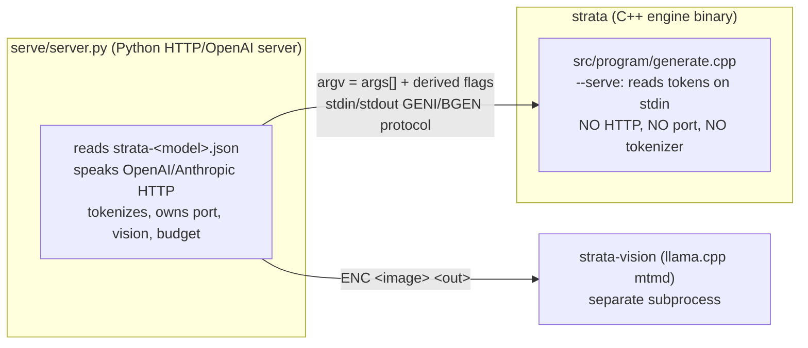
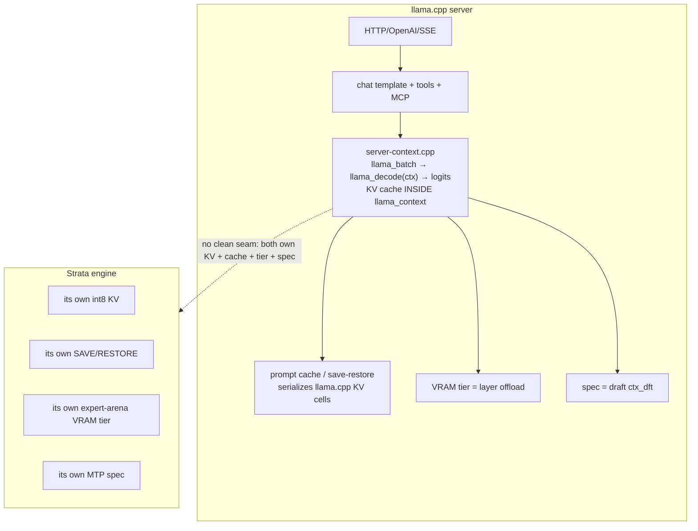

# Strata — integration reference

Notes gathered while wiring the **strata** engine kind into this GUI and resolving the
parameters in a real launch config (`strata-iq3_s.json`). Source of truth:
`/home/ueiricho/Programs/AI/Strata` (read-only reference) and the GitHub project
<https://github.com/robertkarl/UnbiasedStrata>.

---

## 1. The single most important fact: two layers

A Strata deployment has **two distinct programs**, and a `strata-<model>.json` file is
**not** the engine's command line.



- **`serve/server.py`** is the HTTP/OpenAI/Anthropic API server. It reads the whole
  `strata-<model>.json`, owns the network port, the tokenizer, the chat template, the
  vision encoder, and per-request knobs like the thinking budget.
- **`strata`** (the engine binary, built from `src/program/generate.cpp`) only receives
  the config's `args[]` array **plus a few derived flags** (e.g. `--layer-split`,
  `--vision`, `--vram-reserve-mib`). In `--serve` mode it stays resident and exchanges
  **token ids over stdin/stdout** — it has no HTTP server, no port, no tokenizer.

So the keys in a run-config split into **launcher-only keys** (consumed by
`serve/server.py`, no engine flag exists) and **engine flags** (the `args[]` array, plus
derived ones).

---

## 2. Version discrepancy (important gotcha)

| Artifact | Version |
|---|---|
| Compiled engine the GUI launches (`strata-engine-cuda-13/strata`, `BUILD.json`) | **0.1.47** (`source: f-022-rel 76f90e58436d`, cuda 13.0) |
| Source tree at `/home/ueiricho/Programs/AI/Strata` | **0.1.46.3** (git tag `v0.2.1.4`, Control-only bump; engine packages unchanged) |

The compiled binary is **newer** than the checked-out source. Consequence: the binary
accepts flags the source parser does not (e.g. `--pool-cores`). **Always validate flags
against the binary, not just the source**, because the engine hard-errors on any unknown
argument:

```cpp
// generate.cpp — unknown flag is a hard error, not a warning
std::fprintf(stderr, "unknown argument: %s\n", a.c_str());
usage();
return 2;
```

How to extract the real flag set from the binary (note: the compiler pools string
literals, so exact-line `grep -x` misses flags that only appear inside merged literals
like `"it needs --serve"` — use substring search):

```bash
strings /path/to/strata | grep -E '^--[a-z0-9-]+$' | sort -u   # standalone literals
strings /path/to/strata | grep -F -e '--serve'                  # substring check
```

---

## 3. Launcher run-config keys (`strata-<model>.json`)

These are siblings of `args[]`, read by `serve/server.py`. **None of these are engine
flags**, so they must NOT go in the engine param catalog.

| Key | Consumed by | Meaning |
|---|---|---|
| `exe` | launcher | path to the engine binary (`strata`) |
| `args` | launcher → engine argv | the engine flags (see §4) |
| `cwd` | launcher | working directory for the engine |
| `port` | `serve/server.py --port` (default **8095**) | HTTP API port. Engine has **no** `--port`. |
| `tokenizer` | `serve/server.py --tokenizer` | tokenizer dir (default `pack/full/tokenizer`). Engine has **no** `--tokenizer`. |
| `model_name` | `default_model_name()` | the id advertised on `/v1/models`; falls back to family/arch name |
| `log` | `serve/server.py` | file the engine + vision stderr are appended to |
| `lib_dirs` | `serve/server.py` | prepended to `LD_LIBRARY_PATH` (`PATH` on Windows) |
| `gpu` | `serve/server.py` | one card (`2`) or a split list (`[0,2]` / `"0,2"`); sets `CUDA_VISIBLE_DEVICES` + `CUDA_DEVICE_ORDER=PCI_BUS_ID`. (Engine ALSO has `--gpu` which sets it internally.) |
| `gpu_order` | `ordered_gpus()` | `"as_given"` keeps the config order; default puts the **faster card last** for an auto split (#1352) |
| `gpus_asked` | launcher bookkeeping | "setup asked about GPUs" marker; no engine effect |
| `layer_split` | launcher → injects `--layer-split` | `"auto"` (default) or first-layer-of-each-later-card (`"24"`, `"24,36"`) |
| `split_skip_if_fits` | launcher → injects `--split-skip-if-fits` | opt-in |
| `vram_elastic` / `vram_segment_mib` | launcher → injects `--vram-elastic` / `--vram-segment-mib` | opt-in (#533) |
| `reasoning_budget_tokens` | `serve/server.py` request default | caps thinking tokens per request (0 = no budget). **Not** a launch arg. |
| `effort_position` | `serve/server.py` → `--tail-role-token` | `"start"` (default) / `"end"` (#458) |
| `engine_silence_s` | `serve/server.py` | seconds an engine may print nothing before the server ends the request |
| `parallel` | `serve/server.py` → `--batch` | up to N requests decode together (#465) |
| `mcp_servers`, `before_load`, `env`, `aliases`, `idle_unload_s`, `prevent_sleep`, … | `serve/server.py` | server-side features |
| `vision {…}` | separate `strata-vision` subprocess | see §5. Engine only gets `--vision`. |

### How the launcher derives engine args (`serve/server.py: engine_args()`)
- merges `user_args` over generated `args` at every start (#3216)
- `"mtp": false` strips `--mtp*` (draft_layer.strip)
- if a `vision` section exists but `--vision` is absent → appends `--vision`, and for a
  GPU reader also `--vram-reserve-mib 700` (#1322)
- if multi-GPU and no `--peer-device` → appends `--layer-split <value>` (#644)
- `split_skip_if_fits` → `--split-skip-if-fits`
- `vram_elastic` → `--vram-elastic` (+ `--vram-segment-mib`)
- `parallel` → `--batch` / `--batch-groups` (parallel_args)

---

## 4. Engine binary (`strata` = `src/program/generate.cpp`)

- `usage()` is around line 789; the arg parser is a two-part `else if` chain around
  lines 2383–2740 (split because one chain of 120+ `else if` exceeded MSVC's 128-nested-
  block limit).
- **`--serve`** (`o.serve = true`): stay resident, take requests on stdin (the
  launcher's GENI/BGEN protocol). Many flags are gated on `--serve` ("it needs --serve").
- **`--model`** is **only** an alias in the qwen35moe engine path
  (`src/qwen35/q36_engine.cu:3746`, `if (a == "--model" || a == "--native")`). The main
  engine (qwen4exp, e.g. Qwen3.8-Flash-Next) does **not** accept `--model` — it would
  hard-error. Use `--native`.
- **`--version` / `-V`** handled before the parser (line ~2293).

### Flags in the parser but NOT in `docs/strata-parameters.md` (undocumented but real)
These were mined from the parser and confirmed in the binary. All are now in the catalog:

`--adapt-decay` (float), `--adapt-every` (int, default 4), `--adapt-swaps` (int, default
96), `--control-vector` (path, scale 1), `--dump-final-r` (path), `--eos-ids` (i64 list,
implies stop-eos), `--layer-split` (K / K1,K2 / auto), `--mtp-window` (int, default
32768), `--no-fast-attn`, `--no-fast-select`, `--no-fused-gdn`, `--no-kv-grow`,
`--no-prefill-borrow`, `--no-publish-kernel`, `--no-spec-split`, `--no-split-rows`,
`--pcie-frac` (float 0..1), `--pcie-mode` (auto|dma|kernel|direct), `--prefill-until`
(int), `--prompt-cache-root` (int, default 2048), `--resident-budget-gib` (float > 0),
`--serve`, `--spec-corrupt` (int), `--spec-oracle` (path), `--spec-split`,
`--split-device` (D1,D2,..), `--split-skip-if-fits`, `--stop-eos`,
`--vram-reserve-later-mib` (int), `--vram-reserve-mib` (int, default 700).

Binary-only (newer than source): `--pool-cores LIST` (pin CPU workers to exact logical
processors, e.g. `0,2,4,6` or `2-14:2`).

### Selected semantics (from source comments)
- `--expert-cache auto` sizes the VRAM tier from free VRAM minus `--vram-reserve-mib`
  (default 700). Accepts `auto` **or** a number → catalog type is **text**, not number.
- `--vram-reserve-mib`: VRAM left free when sizing the expert cache (graphs, hit scratch,
  head). `--vram-reserve-later-mib`: the reserve on a split's later cards (default = same).
- `--layer-split`: `"K"` or `"K1,K2,.."` (first layer of each later stage) or `"auto"`
  (placed from each GPU's free VRAM); empty = one GPU.
- `--split-device`: later stages' devices (default next visible GPUs; `0` with one K =
  both stages on this GPU, bit-exact A/B).
- `--split-skip-if-fits`: with `--layer-split auto`, run on CUDA0 alone when it holds
  every profiled expert pair + KV + drafter + reserve.
- `--pcie-frac`: share (0..1) of each layer's missed experts read over PCIe while the CPU
  computes the rest (default: pack's own, e.g. 0.2 direct / 0.55 DMA).
- `--adapt-every` / `--adapt-swaps` / `--adapt-decay` / `--adapt-min-gain`: the adaptive
  VRAM expert tier (swap most-routed missing experts for least-routed resident ones every
  N rounds; counts decayed by `--adapt-decay` default 0.7; swap only if gain >
  `--adapt-min-gain` default 1.5).
- `--resident-budget-gib N`: caps the resident expert arena at N GiB; also turns on
  `--mmap-experts --resident-cpu-experts` page-locked.
- `--stop-eos` / `--eos-ids`: stop on end-of-turn tokens (default eos 248044, 248046).
- `--mtp-window`: the draft layer attends to the last N cells (default 32768; 0 = all).
- `--spec-oracle` / `--spec-corrupt`: exactness/reject-path test scaffolding, not for
  normal serving.
- `--no-fast-attn` / `--no-fused-gdn` / `--no-publish-kernel` / `--no-fast-select` /
  `--no-split-rows` / `--no-token-graph` / `--no-fused-gr`: A/B diagnostic arms that swap
  a fused kernel for a reference path.
- `--dump-final-r PATH`: append the post-last-layer residual (the MTP draft head's input)
  after every processed position. Token path only.

---

## 5. Vision (`strata-vision`)

A **separate subprocess** (llama.cpp mtmd + the mmproj file). `serve/server.py`
(`Vision.reader_args`) builds its own argv:

```
strata-vision --mmproj <mmproj> --model <model shard> [--gpu] [--threads N]
              [--max-tokens N] [--min-tokens N]
```

The `vision` section keys: `exe`, `mmproj`, `model`, `gpu` (bool), `threads`,
`max_tokens`, `min_tokens`, `elastic`, `elastic_mib`, `elastic_idle_s`. The engine binary
itself only gets the `--vision` toggle (keeps a per-cell rotary position table so `--serve`
can take GENI image requests). AMD: a GPU reader (`strata-vision-hip`) falls back to the
CPU reader (`strata-vision`).

---

## 6. Talking to the engine binary directly (the stdin/stdout protocol)

The engine binary **does not speak text and does not speak HTTP**. It exchanges **token
IDs** over stdin/stdout. The tokenizer, chat template and HTTP layer all live in
`serve/server.py` — none of that is in the engine. So talking to the binary directly
means **you** tokenize the prompt into IDs and detokenize the output.

### Mode 1 — one-shot (no `--serve`)
Run once with the prompt as token IDs; it prints the result and exits:

```bash
strata --pack .../packs/iq3_s --native .../shard1.gguf --ple-gguf .../shard2.gguf \
       --native --max-new 64 --tokens "248045,872,198,..."
```

stdout ends with (generate.cpp ~16413); everything else (timing, stats) goes to stderr:

```
prompt  : 248045 872 198 ...
output  : 760 3892 316 ...        ← the generated token IDs
decode  : 64 tokens in 812.3 ms  ->  78.79 tok/s
```

The `output  :` line on **stdout** is the answer.

### Mode 2 — persistent serve (`--serve`): the line protocol
Weights load once, then it reads **one command per line on stdin** and writes tokens on
**stdout**. This is what `serve/server.py` drives (its `StrataEngine` class, server.py:933,
is the reference client).

**Handshake:** after loading, the engine prints `READY <max_context> stop`
(generate.cpp ~10937). Wait for that line before sending anything (the server allows up
to 900 s, `STRATA_ENGINE_READY_S`).

**Request (the core command):**
```
GEN <max_new> <id,id,id,...>
```
Optional per-request sampling keys go between `max_new` and the IDs:
```
GEN 256 temperature=0.7 top_p=0.9 top_k=40 seed=42 ckpt=0 pin=512 <ids...>
```
Recognized keys: `temperature`, `top_p`, `top_k`, `min_p`, `penalty_last_n`,
`penalty_repeat`, `penalty_freq`, `penalty_present`, `seed`, `logit_bias`, `cvec=0|1`,
`ckpt=0|1`, `pin=N`, `pcie_frac`, `spec_min_p`. Absent = greedy, no penalties.

**Response lines (stdout), in order:**

| Line | Meaning |
|---|---|
| `RESUME <n>` | n prompt tokens reused from a checkpoint (not re-read) |
| `PP <pos> <total> <ms> <tok/s>` | after each prompt chunk |
| `REUSED <n>` | prompt read; first verify window next |
| `T <id>` | **one generated token id**, streamed as each window finishes |
| `DONE <produced> <prompt_tokens> <prompt_ms> <decode_ms> <stop\|length\|cancel\|nonfinite> <drafts_accepted> <drafts_offered> <reused> … chunk=… experts_streamed=…` | request finished |
| `ERR <message>` | request couldn't run |

**Other commands:**
- `GENI <max_new> <embeddings-file> <ids…>` — images (needs `--vision`); the file holds
  `strata-vision` records (int32 `SVE1`, n, nx, ny, n_embd, then n×n_embd floats) in
  prompt order.
- `STOP` — cancel the running request at its next step.
- `QUIT` — end the process.
- `VRAM <reserve_mib>` — shrink/grow the expert cache between requests (needs
  `--vram-elastic`; the server's `POST /v1/vram`).
- `SAVE <path>` / `RESTORE <path>` — persist a conversation to disk (answers
  `SAVED`/`RESTORED`/`SERR`/`FATAL`; needs `--prompt-cache>0`, no `--layer-split` /
  `--peer-device` / `--batch`).
- With `--batch N`: `BGEN <slot> <max_new> …`, `BSTOP <slot>`, `BYIELD`; output
  `BDONE <slot> …`, `BADM <slot> …`.

**Minimal session:**
```bash
strata --pack ... --native ... --ple-gguf ... --native --serve --max-context 8192
# engine prints: READY 8192 stop
# you send:      GEN 32 248045 872 198
# engine sends:  RESUME 0 / REUSED 0 / T 760 / T 3892 / ... / DONE 32 3 12.0 210.5 length ...
# you send:      QUIT
```

### The practical catch
You must supply **token IDs**, and the vocabulary is the model's own (e.g.
`<|im_start|>` = 248045, `<|im_end|>` = 248046, `<|image_pad|>` = 248056). To get those
IDs you need the tokenizer at `packs/<pack>/tokenizer` — exactly what `serve/server.py`
does for you. To talk to the binary directly you need a tokenizer binding (llama.cpp's
`llama-tokenize`, or the GGUF vocab) to produce the IDs.

---

## 7. Param catalog state (`.config/params.strata.json`)

- Per-install user config; `.config/` is **gitignored**. Served by
  `GET /api/params?kind=strata` (gated by `isEngineKind`), file resolved by
  `paramsFileForKind(kind)` in `src/server/modelConfig.ts`.
- **175 entries**, all verified present in the v0.1.47 binary. Categories and counts:
  `model 9, gpu 21, ple 6, kv 4, experts 19, cpu 8, context 11, sampling 9,
  speculative 15, serve 24, prefill 4, steering 5, native 24, debug 16`.
- `ParamCategory` is an **open union** (`'gpu'|'context'|'sampling'|'reasoning'|
  'speculative'|'other' | (string & {})`), so catalog-only categories (ple, kv, experts,
  cpu, speculative, serve, prefill, steering, native, debug) render fine: `EngineEditor`
  orders llama.cpp's base groups first, then catalog-only categories in catalog order,
  then unknown.
- `inputType` ∈ `text | number | select | preset | toggle | comma-list | path`.
- Recent fixes: `--expert-cache` number → **text** (accepts `auto`); added `--mtp`,
  `--control-vector`, and the 29 undocumented flags in §4.

---

## 8. The user's real config (`strata-iq3_s.json`) resolved

Engine params (what the binary actually receives):

```json
[
  {"flag":"--pack","value":".../packs/iq3_s"},
  {"flag":"--native","value":".../IQ3_S/Qwen3.8-Flash-Next-GSQ-RCO-IQ3_S-00001-of-00002.gguf"},
  {"flag":"--ple-gguf","value":".../IQ3_S/Qwen3.8-Flash-Next-GSQ-RCO-IQ3_S-00002-of-00002.gguf"},
  {"flag":"--expert-profile","value":".../Strata/data/expert-profile.bin"},
  {"flag":"--mtp","value":".../Strata-data/mtp/rt"},
  {"flag":"--expert-cache","value":"auto"},
  {"flag":"--prefill","value":"auto"},
  {"flag":"--spec","value":"4"},
  {"flag":"--spec-min-p","value":"0.5"},
  {"flag":"--max-context","value":"262144"},
  {"flag":"--kv","value":"int8"},
  {"flag":"--kv-resident","value":"262144"},
  {"flag":"--vision"},
  {"flag":"--remote-expert-opt"},
  {"flag":"--ple-io","value":"ram"},
  {"flag":"--pipeline-windows","value":"2"},
  {"flag":"--pool-workers","value":"16"},
  {"flag":"--gpu","value":"1,2,3"},
  {"flag":"--layer-split","value":"auto"}
]
```

Launcher-only (cannot be engine params): `port 5456`, `tokenizer`, `model_name
"Qwen3.8-Flash-Next"`, `log`, `lib_dirs [cuda-13.4/bin, cuda-13.4/lib64]`, `gpu_order
"as_given"`, `gpus_asked true`, `reasoning_budget_tokens 512`, the whole `vision {}`
section, and `cwd`.

---

## 9. How the GUI launches strata today (and the gap)

- `EngineKind = ProxyBackendKind`; `ENGINE_KINDS` / `BACKEND_KINDS` include `'strata'`
  (after `'llamacpp'`). Client mirror in `src/client/types.ts`.
- There is **no dedicated strata driver** → it uses the passthrough driver
  (`splitArgs(extraArgs)` only), which matches the params-only rule.
- `instanceToLlamaConfig` (launch.ts) sets `paramsOnly: true`; `buildLlamaArgs`
  (llama.ts) with `paramsOnly` emits only `-m`/`--mmproj` (or `--models-preset`) +
  extraArgs. For strata the params come through as raw extraArgs.
- **Gap:** the GUI launches the **engine binary directly**, bypassing `serve/server.py`.
  So the launcher-only keys (`port`, `tokenizer`, `vision{}`, `reasoning_budget_tokens`,
  `lib_dirs`, `gpu_order`, …) **cannot be expressed as engine params**. To reproduce a
  full `strata-<model>.json` deployment, the GUI would need a **launcher mode** that runs
  `serve/server.py --config <file> --port <N>` (or `strata serve --profile <file>`)
  instead of the raw `strata` binary.

---

## 10. Useful source locations (read-only reference)

| Path | What |
|---|---|
| `src/program/generate.cpp` | main engine: `usage()` ~789, parser ~2383–2740 |
| `src/qwen35/q36_engine.cu` | qwen35moe engine path (`--model` alias here) |
| `serve/server.py` | the HTTP/OpenAI server; `engine_args()`, `gpu_list()`, `ordered_gpus()`, `layer_split_value()`, `Vision`, `default_model_name()` |
| `strata.py` / `strata_cli/cli.py` | the `strata` terminal CLI (`serve`, `launch`, `profile` subcommands) |
| `strata_cli/launch/runner.py` | `strata launch` interactive launcher; writes run-config keys |
| `apps/host/server/native-settings.mjs` | the web host's native settings (`reasoning_budget_tokens`, `args` validation) |
| `docs/` | DETAILS.md, MULTI_GPU.md, BATCHING.md, IMAGES.md, TERMINAL_LAUNCH.md, MANAGEMENT_PROTOCOL.md, etc. |
| `strata-iq3_s.json`, `run-iq3_s.sh` | example run-config + launch script |

---

## 11. Running Strata without Python

Split the question into **running the engine** vs **getting an HTTP/OpenAI API** — they
have different answers.

| Goal | Python required? |
|---|---|
| Run the engine, talk token↔token (§6) | **No** — the `strata` binary is standalone C++ |
| Get an OpenAI/HTTP endpoint | **Yes** — `serve/server.py` is the *only* HTTP layer |
| Use Strata's own `apps/host` web UI | **Yes** — it spawns `serve/server.py` too |

- The engine binary has **no native HTTP mode**. Confirmed: `src/program/generate.cpp`
  contains no `socket` / `listen` / `http` code — it is a pure stdin/stdout token process.
- **Even Strata's own Node/TS web host still launches Python.** `apps/host` is a nice UI,
  but under the hood it shells out to the same Python server:

  ```js
  // apps/host/server/native-control.mjs:274
  spawnProcess(py, [join(repo(), 'serve/server.py'), '--engine', 'strata',
                    '--config', configPath, '--port', String(cfg.port),
                    '--host', '127.0.0.1'], { cwd: repo(), … })
  ```

  So there is **no Python-free API path** anywhere in the official stack. The only
  Python-free option is **binary-direct** (§6), where *you* own tokenization + the chat
  template.

---

## 12. WASM Hugging Face tokenizer (for a Python-free shim)

The tokenizer at `packs/<pack>/tokenizer/` is HuggingFace `tokenizers` format:

```
tokenizer.json   vocab.json   merges.txt   token_type.json   chat_template.jinja
```

`tokenizer.json` is loadable directly by a WASM/JS binding — no Python needed for
tokenize/detokenize. Live on npm (verified 2026-10):

| Package | Version | What it is |
|---|---|---|
| `@huggingface/tokenizers` | **0.2.0** | **Official HF `tokenizers` Rust crate → WASM. Loads `tokenizer.json` directly. This is the one to use.** |
| `@huggingface/transformers` | 4.3.1 | Transformers.js — bundles tokenizer + ONNX/WASM inference. Overkill if you only need encode/decode. |
| `tokenizers-wasm` | 1.0.0-rc.3 | Community port, less maintained. Skip. |

Shape:

```js
import { Tokenizer } from '@huggingface/tokenizers';
const tok = await Tokenizer.fromFile('.../packs/iq3_s/tokenizer/tokenizer.json');
const enc = tok.encode('hello world', false);   // { ids: [15339, 1917], … }
const text = tok.decode(enc.ids, true);          // back to string
```

Those `ids` feed the engine's `GEN` line (§6); `decode` turns the engine's `T <id>`
output back into text.

**Catches:**
1. **Chat template is separate.** `tokenizer.json` does encode/decode, but the Qwen chat
   template lives in `chat_template.jinja` and is applied by Python `jinja2` in
   `server.py`. The WASM tokenizer does **not** run Jinja — you render the template
   yourself (see §13).
2. **Special-token / BOS handling must match.** `<|im_start|>` = **248045**
   (`server.py:2095`, the engine's default `--turn-token`), `<|im_end|>` = 248046,
   `<|image_pad|>` = 248056. Configure the WASM tokenizer with the same special tokens as
   `token_type.json` / the config's `--eos-ids`, or the engine misreads the prompt.

---

## 13. Replacing `serve/server.py` with a minimal TS server

`serve/server.py` is **8,269 lines**, but almost none of that is the *core loop* — it is
accumulated optional features. A **basic** TS server is realistically **~300–400 lines**;
you replicate the *contract*, not the 8k.

### Layer breakdown

| Layer | ~Lines | Needed for "basic"? |
|---|---|---|
| Engine pump (`strata --serve` stdin/stdout) | 150 | **Yes** — the heart |
| Tokenize / chat-template render | 120 | **Yes** |
| OpenAI `/v1/chat/completions` (stream + non-stream) | 250 | **Yes** |
| Anthropic `/v1/messages`, `/v1/responses` | 400 | No — skip |
| Vision / image encoding | 300 | No — skip |
| Prompt cache, SAVE/RESTORE, VRAM tier mgmt | 600 | No — skip |
| Effort/reasoning steering, MCP, `/slots`, `/props`, `/metrics` | 1000+ | No — skip |
| Speculative, batched, adaptive, watchdog, restart | rest | No — skip |

### The three pieces that must be right

1. **Engine protocol — trivial, already in the source** (`server.py:934`, `:2173`):
   ```
   → stdin:  GEN <max_new> <id>,<id>,…\n
   ← stdout: T <id>\n        (one per generated token)
   → stdin:  STOP\n          (cancel)
   → stdin:  QUIT\n          (shutdown)
   ```
   Wait for the `READY <max_context> stop` handshake before sending (§6). No Python —
   just pipes.

2. **Tokenizer — the WASM package handles it** (§12). `encode(prompt)` → the `ids` for the
   `GEN` line; `decode(ids)` → response text. Genuinely easy.

3. **Chat template — the one real cost.** `serve/chat_template.jinja` is **183 lines of
   Jinja**. For a *basic* server, **hardcode the Qwen3 wrapper** (~15 lines) instead of
   running Jinja:
   ```
   <|im_start|>{role}\n{content}<|im_end|>\n   (per turn)
   <|im_start|>assistant\n                     (trailing, to elicit the reply)
   ```
   You lose the template's edge cases (tool-calling blocks, the "effort" sentence swap at
   `server.py:189`) but gain simplicity. A JS Jinja engine (`nunjucks`, `jinja-js`) won't
   match Jinja semantics — not worth it for "basic as possible".

### Realistic ~350-line shape

```
spawn strata --serve <args>            ← child_process, ~20 lines
GEN/T/STOP/QUIT pump over pipes        ← ~60 lines
@huggingface/tokenizers encode/decode  ← ~15 lines
hand-rolled Qwen3 chat wrapper         ← ~15 lines
Express: POST /v1/chat/completions     ← ~120 lines (SSE streaming)
         GET  /v1/models, /health      ← ~20 lines
```

**Given up by going basic:** vision, Anthropic dialect, prompt cache, SAVE/RESTORE, VRAM
tier control, reasoning-effort steering, MCP, watchdog/restart. If those aren't used,
nothing is lost.

**Verdict:** a basic TS server is **simple** — the engine protocol and tokenizer are easy,
and the chat template collapses to a hardcoded Qwen wrapper. The 8k lines in `server.py`
are optional features, not the core.

---

## 14. Why llama.cpp's server can't host a Strata core

Idea considered: keep llama.cpp's `llama-server` (vision, prompt cache, save/restore,
VRAM tier, reasoning steering, MCP, tools) and swap in the **Strata engine** for the
actual forward pass. **Not feasible as a clean integration** — the features worth reusing
are the model-internal ones, and Strata already owns *incompatible* versions of each.

llama.cpp's decode path is `tools/server/server-context.cpp`. It does not expose a clean
`decode(tokens)→tokens`; it builds a `llama_batch` (token ids + positions + **KV slot
ids**), calls `llama_decode(ctx, batch)`, and reads logits back out of `ctx`. The KV cache
lives *inside* `llama_context`. That file has **30 references to
`llama_batch`/`llama_kv`/`llama_context`/`llama_model`** — there is no seam to drop a
foreign engine into without replacing the KV model too.

### Feature-by-feature: reusable above the model, colliding at/below it

| Feature | Where it lives | Reusable with Strata? |
|---|---|---|
| **MCP** (`server-mcp.cpp`) | text/prompt level | ✅ Yes — model-agnostic |
| **Tools / chat template** (`server-chat.cpp`, `server-tools.cpp`) | text/token level | ✅ Yes — strings + token ids |
| **Reasoning-effort steering** | prompt injection (a system sentence) | ✅ Yes — text level |
| **HTTP / OpenAI / SSE** (`server-http.cpp`) | transport | ✅ Yes |
| **Vision (mtmd)** | image embeddings → fed into KV | ⚠️ Partial — Strata has its own `strata-vision` + `GENI` path (§5/§6); mtmd embeddings won't drop into Strata's KV |
| **Prompt cache / save-restore** | `llama_state_seq_save_file` serializes **llama.cpp KV cells** | ❌ No — Strata's KV is int8, different layout, and Strata already has `SAVE`/`RESTORE` (§6). Two incompatible caches |
| **VRAM tier control** | llama.cpp offloads **layers** to CPU | ❌ No — Strata's tier is an **MoE expert arena** streamed to VRAM; Strata already has `VRAM <reserve_mib>` |
| **Speculative decoding** | llama.cpp uses a **draft context** (`ctx_dft`) | ❌ No — Strata uses **MTP** internally |

The ✅ features sit **above** the model and are genuinely reusable. The ❌ features sit
**at/below** the model and collide head-on with Strata's equivalents. Asking llama.cpp to
manage a KV cache for a model it isn't running is not a swap — it's a rewrite of
`server-context.cpp`'s guts.



### The two architectures that *do* make sense

- **Option A — Strata-native server** (§13): thin shim around Strata's own protocol. You
  get Strata's cache/VRAM/MTP free because they're already in the engine. Reimplement only
  the text-level stuff. Right answer for a Strata model.
- **Option B — shared front-end, engine-selected back-end.** Factor the model-agnostic
  layer (HTTP, OpenAI/Anthropic schema, chat template, tools, MCP, steering) into a
  front-end that talks to *either* a llama.cpp `llama-server` *or* a Strata `--serve`
  process over their token protocols. **This is essentially what this GUI's
  proxy/router already is** — a front-end multiplexing backends. Don't merge the engines;
  keep them as separate backends behind one API.

---

## 15. Implementing the features in TS alongside the tokenizer — effort estimate

The decisive fact: **none of these features are ML to reimplement in TS.** The engine
already implements them and exposes them as **stdin commands** or **prompt-level text**;
TS just drives them. So the TS job is orchestration, not inference.

### Feature → existing engine command / text mapping

| Feature | Engine already does it? | How (verified in `server.py`) |
|---|---|---|
| Prompt cache | ✅ engine | `GEN` reuses via `RESUME`/`REUSED`; per-request `ckpt=`/`pin=` keys |
| Save / restore | ✅ engine | `SAVE <path>` / `RESTORE <path>` (§6) |
| VRAM tier control | ✅ engine | `VRAM <reserve_mib>` line; `/v1/vram` (`server.py:6388`) just forwards it |
| Speculative (MTP) | ✅ engine | `--spec`, per-request `spec_min_p=` |
| Vision | ✅ engine + `strata-vision` | `GENI <max_new> <embed-file> <ids…>` (`server.py:2170`); encoder is a separate subprocess |
| Reasoning-effort steering | ✅ text-level | `EFFORT_TURN = "<|im_start|>system\n{}<|im_end|>\n"` (`server.py:184`) — a string injected into the prompt; `effort_position` start/end via `--tail-role-token` (`:2836`) |
| Tools / MCP / chat template | ✅ text-level | operate on messages + token ids, model-agnostic |

### Per-piece estimate

| Piece | TS work | ~LOC | Difficulty |
|---|---|---|---|
| Engine spawn + `GEN`/`T`/`DONE`/`STOP`/`QUIT` pump | drive pipes, parse lines | 80–120 | Easy — protocol documented (§6) |
| Tokenizer (WASM) | `encode`/`decode` + special tokens | 20–40 | Easy |
| Chat template (Qwen3) | hardcode wrapper | 20–40 | Easy (100+ if tool-calling blocks must be exact) |
| OpenAI `/v1/chat/completions` (stream + non-stream) | SSE, usage, finish_reason | 150–250 | Medium — fiddly but mechanical |
| Reasoning-effort steering | inject `EFFORT_TURN`, budget→`max_new` cap | 30–60 | Easy — it's a string |
| Save / restore | forward `SAVE`/`RESTORE`, map to session id | 40–80 | Easy |
| VRAM tier | forward `VRAM <mib>` | 15–25 | Trivial |
| Prompt cache | mostly free (`RESUME`); expose `ckpt`/`pin` | 20–40 | Easy |
| Speculative | mostly free; pass `spec_min_p` | 10–20 | Trivial |
| Tools / function-calling | parse tool calls, schema | 150–300 | Medium — template's tool blocks are tricky |
| MCP | `/mcp` endpoint | 100–200 | Medium — optional |
| Vision | spawn `strata-vision`, write `SVE1` file, `GENI` | 150–250 | Medium — binary format + subprocess |
| Anthropic `/v1/messages` | second dialect | 150–250 | Medium — optional |
| `/health` `/v1/models` `/props` `/slots` | status passthrough | 60–120 | Easy |

### Scoped totals

| Scope | LOC | Effort (focused) |
|---|---|---|
| **Core** (engine pump + tokenizer + template + OpenAI chat + effort steering) | ~350–500 | **2–4 days** |
| **+ session/cache/VRAM/spec** (all "free" engine forwards) | +150–250 | **+1–2 days** |
| **+ tools / function-calling** | +200–300 | **+2–3 days** (template edge cases) |
| **+ vision** | +200–250 | **+2–3 days** (SVE1 format, subprocess) |
| **+ Anthropic + MCP + full status** | +400–600 | **+3–5 days** |
| **Full parity with `server.py`'s surface** | ~1,500–2,000 | **~3–4 weeks** |

### Where the real risk is (fidelity, not volume)

1. **Chat template exactness.** `server.py` uses a 183-line Jinja template with
   tool-calling blocks and the effort-sentence swap (`:189`). A hardcoded wrapper is fine
   for plain chat; matching it *exactly* for tools + reasoning is where bugs hide. Biggest
   correctness risk.
2. **Special-token / BOS parity.** `<|im_start|>`=248045 etc. must match or the engine
   misreads prompts (§12).
3. **The `DONE` line's many fields** (`produced prompt_tokens prompt_ms decode_ms
   stop/length/cancel drafts… reused chunk= experts_streamed=`) — parse what you need;
   usage stats come free.
4. **Vision's `SVE1` binary format** (int32 magic, n, nx, ny, n_embd, then n×n_embd
   floats) — small but the byte layout must be exact.
5. **Concurrency.** `server.py` serializes one sequence behind a FIFO (or `--batch N` with
   `BGEN`). A basic TS server can copy the single-queue model; parallelism is extra.

### Bottom line

Because the engine already implements cache/save-restore/VRAM/MTP/vision and exposes them
as commands, **TS-side work is orchestration, not ML**.

- **Capable basic server** (chat + steering + save/restore + VRAM + spec, all driving
  existing engine commands): **~500–750 lines, ~1 week.** ← the sweet spot
- **Full feature parity** (tools, vision, Anthropic, MCP): **~1,500–2,000 lines, ~3–4
  weeks** — at which point you've rebuilt most of `server.py` in TS, which reopens the
  question of whether it's worth it versus just driving `serve/server.py` (the
  launcher-mode design, §9).
